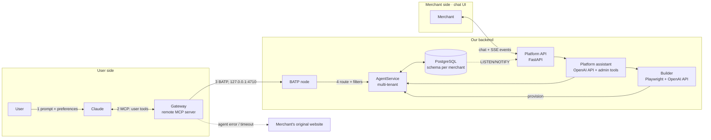

# AGENTS.md — Sésame

> Let Claude book with any merchant, straight from their website.

This file is the single source of truth for this repository. Read it fully before writing code. When something is not specified here, follow **§13 Default decisions** instead of asking, and record any new decision in **§14 Decision log**.

`CLAUDE.md` only imports this file (`@AGENTS.md`), so Claude Code and opencode read the same instructions. Edit this file, never `CLAUDE.md`.

Architecture, component boundaries and invariants: [`documentation/ARCHITECTURE.md`](documentation/ARCHITECTURE.md). Decision records: [`documentation/adr/`](documentation/adr/README.md). Exact tool fields and validation rules: [`documentation/CONTRACTS.md`](documentation/CONTRACTS.md). Agent protocol: [`documentation/PROTOCOL.md`](documentation/PROTOCOL.md). Work is tracked in GitHub issues; [#26](https://github.com/MaxEntz/BaselHack2026/issues/26) lists them.

## 1. What we are building

A merchant (first vertical: **restaurants**) brings **their existing website** and a **short description** of how they work. Our AI reads the site, combines it with the description, and **generates a dedicated agent** for that merchant: its own data (tables, time slots, reservations, policies) and its own **MCP tools**.

Two conversational experiences sit on top:

1. **User side, in Claude.** A user asks Claude: *"Table for 4 tonight at 8pm."* Claude calls our **gateway** (one remote MCP server, added once as a connector). The gateway applies the user's **preferences** as filters, finds the merchant, and routes the call to the merchant's agent, which books. **If the agent fails, the gateway returns a fallback URL to the merchant's original website.**
2. **Merchant side, on our platform.** The merchant manages everything **by chatting with a platform assistant**: onboarding (give the URL, describe the business, the agent gets built), then day-to-day operations (*"What bookings do I have tonight?"*, *"Block 21:00 tonight"*, *"Set max party size to 6"*, *"Cancel R-001"*). New bookings made through Claude show up **live** in the merchant's conversation.

There is **no form-based UI** on either side: everything is a conversation. Structured results (booking card, reservations table, agent profile) are rendered as rich messages inside the chat.

## 2. Glossary

| Term | Meaning |
|---|---|
| **Gateway** | The public remote MCP server Claude connects to: discovery, preference filtering, routing, fallback. Deployed, it is a bridge to the BATP node. |
| **BATP** | Broad Agent Transfer Protocol, our agent-only protocol: TCP port 4710, one JSON frame per line ([ADR-0011](documentation/adr/0011-our-own-agent-protocol-matp-with-mcp-as-bridge.md), [ADR-0014](documentation/adr/0014-rename-matp-to-batp.md)). |
| **Node** | The BATP server that serves this backend's merchant agents (`merchant_node`). |
| **Merchant agent** | One merchant's booking logic and data. Logically one per merchant; physically one multi-tenant `AgentService` plus the merchant's Postgres schema. |
| **Builder** | Pipeline that turns *website + description* into a validated `MerchantProfile`, then provisions the agent. |
| **Platform assistant** | The LLM assistant merchants chat with on our platform. Uses admin tools on the merchant's agent. |
| **MerchantProfile** | Validated JSON describing a merchant (`core.models.MerchantProfile`). Single input to provisioning. |
| **Fallback URL** | Link to the merchant's own booking page, returned whenever the agent can't serve a request. |

## 3. Architecture



Without `BATP_URL` (development, tests) the gateway calls the `AgentService` in its own process, behind the `AgentClient` interface. The step-by-step flow is in ARCHITECTURE.md §3.

## 4. Repository layout

All code lives in `code/` (BaselHack template: `code/`, `documentation/`, `assets/`). Run every command from `code/`.

```
code/
├── Makefile, pyproject.toml (uv workspace), docker-compose.yml, alembic.ini, .env.example
├── packages/
│   ├── core/src/core/             models.py, errors.py, db.py, availability.py, config.py, logs.py
│   ├── agent/src/agent/           service.py (PgAgentService), admin.py, provisioning.py, templates/restaurant.json
│   ├── gateway/src/gateway/       server.py, merchant_server.py, discovery.py, fallback.py, agent_client.py
│   ├── batp/src/batp/             messages.py, codec.py, status.py, client.py, server.py
│   ├── merchant_node/src/merchant_node/   agents.py (the BATP node)
│   ├── builder/src/builder/       crawl.py, extract.py, build.py, cache.py, llm.py
│   └── merchant_platform/src/merchant_platform/   api.py, assistant.py, tools.py, events.py, sessions.py
├── web/                           merchant chat UI (Vite + React + TS), types.ts, mocks/
├── sites/                         the 3 demo restaurant websites (in French)
├── migrations/versions/           Alembic, `public` schema only
├── scripts/                       seed, demo reset, outage switch, crawl, benches, BATP schemas
├── deploy/                        systemd units, Caddyfile
└── tests/{unit,integration,e2e,fixtures}/
```

`code/README.md` describes each directory and script.

## 5. Stack (fixed for the POC)

| Area | Choice | Rejected |
|---|---|---|
| Language | **Python 3.12**, managed with **uv** | Go/Rust gateway |
| MCP | Official **`mcp` SDK v2** (`from mcp.server import MCPServer`; `FastMCP` no longer exists, don't copy v1 examples), **Streamable HTTP**. Behind a proxy, set `allowed_hosts` or the transport answers 421 | REST API re-exposed as tools |
| Agent protocol | **BATP** (`packages/batp`, `packages/merchant_node`), MCP kept as Claude's bridge | Implementing AGTP; JSON over HTTPS |
| API | **FastAPI** + **Pydantic v2** | Flask, Django |
| DB | **PostgreSQL 16**, **SQLAlchemy 2.0** (async, psycopg 3), **Alembic** | SQLite |
| Crawl | **Playwright** (Chromium) | requests + BeautifulSoup |
| LLM (backend) | **OpenAI Python SDK** (Responses API), `OPENAI_API_KEY`, `OPENAI_MODEL` (default `gpt-6.1-terra`). Claude stays the **user-side** client | Anthropic SDK (the team's key is OpenAI's) |
| Live events | Postgres **LISTEN/NOTIFY → SSE** | Redis pub/sub, WebSockets |
| Front | **Vite + React + TypeScript** | Next.js |
| Tests | **pytest**, **pytest-asyncio**, **testcontainers** (Postgres); web: Node's test runner | Mocked DB |
| Lint/format | **ruff**, **mypy --strict** on `core`, `agent`, `gateway`, `batp`, `merchant_node` | |

Reasons for each choice: [ADR-0002](documentation/adr/0002-python-mcp-v2-fastapi-postgres-react-stack.md), [ADR-0004](documentation/adr/0004-openai-for-backend-llm-calls.md), [ADR-0011](documentation/adr/0011-our-own-agent-protocol-matp-with-mcp-as-bridge.md).

## 6. Domain rules (restaurant vertical)

- A reservation occupies its table for **120 minutes** (`slot_length_min`).
- Bookable start times: every **30 min** within each service, **last seating = service end − 60 min**.
- Table assignment: smallest table with `seats >= party_size` that has **no overlapping reservation** and whose start time is **not blocked**.
- `party_size > max_party_size`, or no table that fits → `party_too_large` + `fallback_url`.
- Availability search returns up to **3 slots**, closest to the requested time, sorted by time.
- **Every write initiated from Claude requires explicit user confirmation** in the conversation, after Claude has shown what it will book. A confirmation given before that summary doesn't count, and a write never goes in the same reply as the `search_merchants` or `get_availability` call the summary is based on. A re-check of availability after the yes may go with the booking, unless it no longer offers the confirmed time: then Claude shows the new times and asks again. Enforced by the tool descriptions and by `idempotency_key` on writes (#14, #109).
- A guest can move or cancel a booking only before it starts; updates and cancellations also need `guest_name`.
- A merchant cancelling a booking **notifies the guest**: a stored notice, returned by `get_my_reservations` for 24 hours after it is first returned.
- Blocking a slot never removes existing bookings; it only prevents new ones at that start time.

## 7. Data model

### 7.1 MerchantProfile

`core.models.MerchantProfile`: `slug`, `name`, `website`, `vertical` (`restaurant`), `location?` (`city`, `lat`, `lng`), `seats`, `services` (`[{start, end}]`, `HH:MM`), `max_party_size`, `tables` (`[{label, seats}]`), `tags` (`gluten-free`, `vegetarian`, `vegan`, `halal`, `kosher`, `terrace`, `kid-friendly`), `price_level` (`€`…`€€€€`), `cancellation_policy?`, `fallback_url`. The LLM **only fills a schema** (`ProfileDraft`): it never generates code, SQL or tool definitions ([ADR-0003](documentation/adr/0003-llm-fills-a-schema-never-generates-code.md)).

### 7.2 Database

One Postgres schema per merchant ([ADR-0001](documentation/adr/0001-one-postgres-schema-per-merchant.md)). Source of truth: `code/packages/core/src/core/db.py` and `code/migrations/versions/`.

| Where | Tables |
|---|---|
| `public` (Alembic, migrations `0001`–`0003`) | `merchants` (registry: slug, name, website, fallback_url, city, tags, price_level, `status` `building`/`live`/`down`, default `building`, `profile` jsonb), `guest_notices`, `reservation_changes` (applied update keys, [ADR-0013](documentation/adr/0013-store-update-idempotency-keys-in-public.md)), `agent_requests` (the BATP node's request log, 7 days, #146), function `notify_reservation()` |
| `m_<slug>`, one per merchant | `tables`, `policy` (one row), `blocked_slots`, `reservations` (`EXCLUDE USING gist (table_id WITH =, during WITH &&) WHERE status = 'confirmed'`; `during` never empty; `via` `claude`/`merchant`/`website`), triggers `reservations_notify` (sends `schema`, `op`, `id`, `status`, `via`) and `reservations_skip_noop` |

Rules for DB code:

- Merchant tables are declared once in SQLAlchemy Core under the placeholder schema `merchant`; `merchant_metadata.create_all` on a translated connection builds a whole merchant schema. No migrations for merchant schemas: drop and re-provision.
- Always query merchant tables through `merchant_conn(engine, slug)` (`schema_translate_map` → `m_<slug>`) with Core constructs, **never `text()`**, which is not translated.
- Schema name = `m_` + slug with `-` → `_`; slugs are ≤ 61 characters (Postgres identifiers: 63 bytes). Turn a slug into a schema only with `schema_for(slug)`. Reservation IDs come from `next_reservation_id(conn)`.

## 8. Tool contracts

Exact fields, bounds and error cases: [`documentation/CONTRACTS.md`](documentation/CONTRACTS.md). Tools take flat typed arguments (the fields of the `*Input` models in `core/models.py`) and return `<Result> | ToolError`.

### 8.1 User tools

Gateway, `/mcp` (the descriptions tell Claude to confirm writes, pass preferences as `filters`, and give any `fallback_url` to the user):

- `search_merchants`: live merchants matching the query, tags and price, with `suggestions` of filters to drop and `ignored_filters`.
- `get_availability`: up to 3 slots.
- `create_reservation` / `update_reservation`: book or change, with `idempotency_key`.
- `cancel_reservation`: cancel as the guest.
- `get_my_reservations`: a guest's bookings and notices.

Each merchant also has `/m/<slug>/mcp` with the 4 booking tools, without `merchant` ([ADR-0012](documentation/adr/0012-one-mcp-server-for-every-merchant-endpoint.md)).

### 8.2 Admin tools

Platform assistant only, never exposed to Claude users: `build_agent`, `list_reservations`, `get_stats`, `block_slot`, `unblock_slot`, `update_policy`, `update_tables`, `cancel_reservation` (as the merchant, with a guest notice).

### 8.3 Builder steps

Streamed as events into the merchant chat:

1. `crawl`: Playwright loads the homepage + up to 5 same-domain pages whose path or link text matches `menu|carte|karte|hours|horaires|zeiten|contact|kontakt|book|reserv` (accents ignored).
2. `extract`: a forced strict function call fills `ProfileDraft` from the crawled text and the description (the description wins on conflicts).
3. `validate`: Pydantic; one retry with the errors fed back, then a message to the merchant.
4. `provision`: schema `m_<slug>`, tables, policy, registry row in `building`.
5. `deploy`: `status = 'live'`; the merchant is now discoverable.

### 8.4 Errors

Every tool error is `{ "error": <code>, "message": str, "fallback_url"?: str }`.

| Code | When | `fallback_url` |
|---|---|---|
| `agent_unavailable` | Agent or node timeout (> **2 s** for the whole call), exception, or merchant `down` | yes |
| `party_too_large` | Party above `max_party_size`, or no table fits | yes |
| `slot_unavailable` | Slot taken or blocked, or booking already started | no |
| `not_found` | Unknown merchant or reservation | no |
| `invalid_input` | Validation error | no |

## 9. Conversations to support (acceptance scenarios)

**User ↔ Claude (via the gateway)**
- "Table for 4 tonight at 8pm" → `search_merchants` with preference filters → `get_availability` → Claude proposes slots → user picks → Claude asks to confirm → `create_reservation` → booking card.
- "Move it to 9pm" → `update_reservation`. "Cancel my booking" → `cancel_reservation`.
- Vegan preference on, merchant not tagged vegan → no match, Claude offers to drop the filter.
- "Table for 8" when max is 6 → `party_too_large` → Claude gives the fallback link.
- Agent down → `agent_unavailable` → Claude gives the fallback link.

**Merchant ↔ platform assistant**
- Onboarding: assistant asks for the website → asks for the description → calls `build_agent` → shows step progress → shows the agent profile card.
- "What bookings do I have tonight?" → `list_reservations` → table message.
- "Block 21:00 tonight" → `block_slot`; Claude users no longer get 21:00.
- "Set max party size to 6" → `update_policy`.
- "How busy are we tonight?" → `get_stats`.
- "Cancel R-001" → `cancel_reservation(by="merchant")` → guest notice created.
- A booking made through Claude appears in the merchant chat as a **"New booking via Claude"** notification within 2 s (SSE).

How to run them against the deployed gateway: [connector runbook](documentation/runbooks/connector.md), step 4.

## 10. Commands

From `code/` (all targets: [`code/README.md`](code/README.md)):

```bash
make setup && make db && make migrate   # deps, Postgres 16, migrations
make test                               # uv run pytest (testcontainers starts Postgres)
make lint                               # ruff check, ruff format --check, mypy
make gateway    # MCP server        -> http://localhost:8001/mcp
make node       # BATP node         -> batp://127.0.0.1:4710
make platform   # Platform API      -> http://localhost:8002
make web        # merchant chat UI  -> http://localhost:5173
make sites      # demo websites     -> http://localhost:8080, :8081, :8082
make demo-reset # known demo state; make outage / make restore SLUG=…
make deploy     # gateway + node to the team server
```

Env (`code/.env.example`): `DATABASE_URL`, `OPENAI_API_KEY`, `OPENAI_MODEL`, `MERCHANT_TZ=Europe/Zurich`, `AGENT_TIMEOUT_MS=2000`, `GATEWAY_PUBLIC_URL`, `BATP_URL`, `BATP_TOKEN`, `BATP_TOKENS`, `PLATFORM_MERCHANT`.

## 11. Milestones

All done; open work is tracked in [#26](https://github.com/MaxEntz/BaselHack2026/issues/26).

- **M1, core and agent runtime:** pure availability rules, provisioning from a fixture, and two concurrent bookings of one table and slot → exactly one succeeds (real Postgres).
- **M2, gateway:** the §8.1 tools, preference filtering, 2 s timeout, §8.4 errors; e2e through an MCP client; connected to Claude.
- **M3, merchant side:** `/chat` with the §8.2 admin tools, `/events` SSE from `LISTEN/NOTIFY`, the web chat's rich messages.
- **M4, builder:** crawl, extraction, validation and provisioning streamed into the chat; profiles of 3 real restaurant websites stored as fixtures (`code/tests/fixtures/generated/`).

**Definition of done (POC):** the whole §9 list runs end to end: the merchant onboards by chat, a user books from Claude, the merchant sees it live and blocks a slot, an outage triggers the fallback.

## 12. Conventions

- Business logic lives in `core` and `agent` as **plain functions/classes**; MCP, BATP and HTTP layers are thin adapters.
- No raw SQL string building from user input; parameterized queries only. Schema names come from validated slugs.
- Every tool validates input with Pydantic and returns §8.4 errors, never stack traces.
- Log every tool call (tool, merchant, latency, outcome) as structured JSON; never log guest names at INFO.
- Tests first for `availability.py` and anything touching the exclusion constraint.
- Commits: Conventional Commits (`feat:`, `fix:`, `test:` …).
- **Contracts** (`core/models.py`, the `AgentService` protocol, `web/src/types.ts`) change only in a dedicated PR announced to the team.
- **Living docs, same PR as the code**: update `documentation/ARCHITECTURE.md` when you add, rename or remove a component, change the main flow, the stack, a protocol or data format, or a guarantee. A new or replaced technology or a structural choice gets a new ADR in `documentation/adr/` (never edit an accepted one: supersede it).
- Everything in the repo is in **English**: code, comments, docs, commits, PRs, issues. Only the demo sites' content is in French.

## Module rules

- **Provisioning** (`agent/provisioning.py`): `provision(profile)` (one transaction: schema, tables, policy, registry row in `building`), `deploy(slug)` / `set_status(slug, "live"|"down")`, `deprovision(slug)` (idempotent). Each takes an optional `engine=`: long-running processes pass theirs; scripts omit it and get a short-lived engine on `DATABASE_URL`. A slug in use raises `SlugTaken` (an `InvalidInput`). `default_tables(seats)` and `generated_tools(profile)` are pure; `templates/restaurant.json` is validated at import.
- **Merchant operations** (`agent/admin.py`): one `merchant_conn` transaction each, so the merchant schema and the registry's `profile` change together. The merchant's `tables` and `policy` rows are authoritative; `profile` is a display copy kept in sync. They load the merchant with `merchant_side=True` (a `building` merchant is editable by its owner, hidden from guests). Input outside the database's range is `InvalidInput`, never a raw DB error.
- **Gateway** (`gateway/`): only `fallback.py` turns failures into `ToolError`; arguments the SDK rejects also answer `invalid_input`. `search_merchants` answers `agent_unavailable` + `fallback_url` when its query names a `down` merchant and no live one. Fault injection: `CHAOS_DELAY_MS`, `CHAOS_MERCHANTS`. As a bridge, it still reads the registry for the `down` status and the fallback URL.
- **BATP**: the library (`packages/batp/`) depends only on `core`, so the gateway can import its client. Change the protocol in `PROTOCOL.md`, the draft in `documentation/rfc/`, the library and its tests together.

## Team server (LXC)

We have a server: use it to test anything Claude.ai must reach, instead of opening a tunnel. Full runbook: [`documentation/runbooks/connector.md`](documentation/runbooks/connector.md).

- **Host:** `root@191.96.88.152`, Ubuntu 24.04. SSH by key only, passwords are refused.
- **SSH key:** `~/.ssh/baselhack2026_lxc` on the user's machine. If it isn't there, **ask the user**, they may have it. Never commit a private key or paste it in a conversation.
  ```bash
  ssh -i ~/.ssh/baselhack2026_lxc -o IdentitiesOnly=yes root@191.96.88.152
  ```
- **Gateway:** `https://191-96-88-152.sslip.io/mcp`, deployed with `make deploy` from `code/`. Code in `/opt/merchant-agents/code`, service `merchant-gateway`, HTTPS by Caddy. Caddy only lets Anthropic's outbound range (`160.79.104.0/21`) through and answers `403` to everyone else: test with a local gateway, or run the SDK client on the server over SSH against `http://127.0.0.1:8001/mcp`, not with the public URL (SSH port forwarding is disabled on the server).
- **BATP node:** service `merchant-node` (`code/deploy/merchant-node.service`), installed and restarted by `make deploy` with the gateway, bound to `127.0.0.1:4710` only; the gateway reaches it through `BATP_URL=batp://127.0.0.1:4710`. Port 4710 is never opened without asking (TLS + firewall rule on the shared server). Logs: `journalctl -u merchant-node`.
- **The server is shared, it doesn't only run the gateway.** Ask the user before rebooting it, stopping a service or changing anything outside `/opt/merchant-agents`. When `code/deploy/Caddyfile` changed, `make deploy` validates it, overwrites `/etc/caddy/Caddyfile` and restarts Caddy, so any other site must also be declared there.
- **Firewall (`/etc/nftables.conf`):** only ports 22, 80 and 443 are open inbound, and new outbound connections to private networks are refused. A new service needs a rule there. `fail2ban` bans IPs that repeatedly fail SSH logins.
- **Postgres:** `postgresql-16` on the server, listening on localhost only, database `merchant_agents` (UTF-8), credentials in `/opt/merchant-agents/code/.env`. `make deploy` applies the migrations but doesn't seed. `make outage` and `make seed` act on your local database: for the server's, see the runbook.

## 13. Default decisions (apply without asking)

- **One agent per merchant** is a logical boundary: one multi-tenant `AgentService` keyed by slug, data isolated by Postgres schema. No per-merchant processes.
- **Gateway and agents**: separate processes through BATP when deployed; the same process without `BATP_URL`.
- **Auth:** the public gateway only lets Anthropic's range through ([ADR-0010](documentation/adr/0010-allow-only-anthropics-outbound-range-on-the-public-gateway.md)); `GATEWAY_TOKEN` is optional. Merchant platform: single hard-coded merchant session.
- **Guest identity:** the `guest_name` Claude passes; no accounts.
- **Guest notices** (merchant cancellations): stored per guest name and returned by `get_my_reservations`; no push to Claude.
- **Fallback depth:** return the URL only; Claude does not drive the website.
- **Timezone:** `Europe/Zurich` everywhere; store `timestamptz`.
- **Discovery:** single city, filter by tags and price only; no ranking beyond name order.
- **Preferences** are never stored server-side; they only arrive as `filters`.
- Missing info in a merchant description → template defaults (`slot_length_min=120`, `max_party_size=8`, services `19:00–22:00`), and the merchant is told in chat what was assumed.

## 14. Decision log

Superseded rows are removed; the reasons are in the linked ADR, issue or PR.

| Date | Decision | Ref |
|---|---|---|
| 2026-10-31 | Python, MCP SDK v2 (`mcp` 2.3.0), Postgres, FastAPI, Vite/React | [ADR-0002](documentation/adr/0002-python-mcp-v2-fastapi-postgres-react-stack.md), #3 |
| 2026-10-31 | The LLM fills a schema, never writes code | [ADR-0003](documentation/adr/0003-llm-fills-a-schema-never-generates-code.md) |
| 2026-10-31 | Both sides are chat-only | §1 |
| 2026-10-31 | Code in `code/`; package `platform` renamed `merchant_platform` | [ADR-0005](documentation/adr/0005-rename-platform-package-to-merchant-platform.md) |
| 2026-10-31 | OpenAI API for every backend LLM call | [ADR-0004](documentation/adr/0004-openai-for-backend-llm-calls.md), #4 |
| 2026-10-31 | `AGENTS.md` is the shared instruction file, `CLAUDE.md` imports it | — |
| 2026-10-31 | Contracts frozen in #2; later changes need a dedicated PR | #2 |
| 2026-10-31 | Guest updates and cancellations require `guest_name` | [ADR-0008](documentation/adr/0008-deviations-from-the-original-tool-contracts.md) |
| 2026-10-31 | Discovery returns `suggestions` and `ignored_filters`; search tags accept unknown strings | [ADR-0008](documentation/adr/0008-deviations-from-the-original-tool-contracts.md) |
| 2026-10-31 | `BuildAgentOutput` has `assumptions`, `tools`, `mcp_url`; admin tool `update_tables` | [ADR-0008](documentation/adr/0008-deviations-from-the-original-tool-contracts.md) |
| 2026-10-31 | Optional profile fields default to `None`; `HHMM` is a real 24-hour time | #2 |
| 2026-10-31 | Contract models use tuples, reject blank identities, bad floor plans, overlapping or sub-hour services and no-op updates; SSE events are Pydantic models | #2 |
| 2026-10-31 | `max_party_size` may exceed the largest table, `seats` may differ from the tables' total; no fitting table is `PartyTooLarge` | #7, #10 |
| 2026-10-31 | One Postgres schema per merchant, tables declared once in Core; no merchant-schema migrations | [ADR-0001](documentation/adr/0001-one-postgres-schema-per-merchant.md) |
| 2026-10-31 | Gateway on the team server behind Caddy (`sslip.io`), bound to `127.0.0.1`; `GATEWAY_TOKEN` optional; ngrok as alternative | [ADR-0009](documentation/adr/0009-serve-the-gateway-from-the-team-server-behind-caddy.md) |
| 2026-10-31 | The public gateway only accepts Anthropic's range `160.79.104.0/21` | [ADR-0010](documentation/adr/0010-allow-only-anthropics-outbound-range-on-the-public-gateway.md) |
| 2026-10-31 | Platform assistant on the OpenAI Responses API behind `LLMClient`, provider-neutral history, `store=False`, effort `low` | #17 |
| 2026-10-31 | `llm.py` lives in `builder`, shared with the assistant; `BUILDER_REASONING_EFFORT` defaults to `none` | #22 |
| 2026-10-31 | Builder: the LLM fills `ProfileDraft`; the code sets slug, website, vertical, tags, `fallback_url` and the floor plan, each default announced as an assumption | #22 |
| 2026-10-31 | `build_agent` refuses a website that already has an agent; a build stopped before `deploy` is deprovisioned; only `PLATFORM_MERCHANT` attaches a session to an existing agent | #22 |
| 2026-10-31 | Builder cache (`BUILDER_CACHE`) for a replayable demo | [ADR-0007](documentation/adr/0007-builder-cache-for-a-replayable-demo.md) |
| 2026-10-31 | Chat cards rendered from tool results | [ADR-0006](documentation/adr/0006-chat-cards-rendered-from-tool-results.md) |
| 2026-10-31 | Keep "Le Petit Zinc": its site says on every page that it is fictional | #16 |
| 2026-10-31 | La Graine Verte and Maison Albane have one-page sites on :8081 and :8082; their `fallback_url` is `#reserver` | #16 |
| 2026-10-31 | `search_merchants` answers `agent_unavailable` + `fallback_url` when the query names only a `down` merchant | #11, #13 |
| 2026-10-31 | Tools declare typed arguments; an MCP middleware turns SDK rejections into `invalid_input` | #13 |
| 2026-10-31 | One second `MCPServer` serves every `/m/<slug>/mcp` | [ADR-0012](documentation/adr/0012-one-mcp-server-for-every-merchant-endpoint.md), #23 |
| 2026-10-31 | Our own agent protocol, MCP kept as Claude's bridge; renamed MATP → BATP | [ADR-0011](documentation/adr/0011-our-own-agent-protocol-matp-with-mcp-as-bridge.md), [ADR-0014](documentation/adr/0014-rename-matp-to-batp.md), #119 |
| 2026-10-31 | As a bridge, the gateway still reads the registry for `down` and the fallback URL | #61 |
| 2026-10-31 | Postgres on the team server, localhost only; `make deploy` applies the migrations | #25 |
| 2026-10-31 | Booking writes lock the table's row inside each SAVEPOINT; the exclusion constraint stays the guarantee | #8 |
| 2026-10-31 | A booking re-reads its table's seats under the lock | #9 |
| 2026-10-31 | `update_tables` refuses to remove a table that bookings refer to; no `active` flag | #9 |
| 2026-10-31 | `update_policy` gives no warning about bookings above a lowered `max_party_size` | #9 |
| 2026-10-31 | The crawler checks every request after DNS resolution, follows redirects itself, loads text only; link-local always refused; DNS rebinding not covered | #21 |
| 2026-10-31 | Crawl link filter also matches German; crawl failures are `InvalidInput` shown in the `crawl` step | #21 |
| 2026-10-31 | A guest notice is returned for 24 real hours after the first call that returned it | #91 |
| 2026-10-31 | Guest text ≤ 200 characters without control characters; guest dates between 2000 and 2099; no guest change after a booking starts | #79 |
| 2026-10-31 | Applied update keys stored in `public.reservation_changes`; a replay returns the booking as it is now | [ADR-0013](documentation/adr/0013-store-update-idempotency-keys-in-public.md), #78 |
| 2026-10-31 | `cancel_by_merchant` returns what the cancellation did; the card words it | #82 |
| 2026-10-31 | Extraction prompt `v2.2`: price bands, kitchen hours, `max_party_size` rule, one-page fallback anchors | #74 |
| 2026-10-31 | Weekly closing days only become an assumption (prompt `v2.3`); `Service` keeps no weekdays | #73 |
| 2026-10-31 | Live events only report guests' changes; `LiveEvent` has the booking's `date` | #81 |
| 2026-10-31 | `llm` tests run in their own workflow on `main` and by hand, never on pull requests | #75 |
| 2026-10-31 | `AGENT_TIMEOUT_MS` is one deadline per tool call | #92 |
| 2026-10-31 | A query names a merchant only when it holds every distinctive word of its name | #89 |
| 2026-10-31 | `GET /session` tells the web which merchant its chat session works on | #88 |
| 2026-10-31 | Write confirmation: a pre-confirmation doesn't count; no write in the same reply as the call the summary is based on, a re-check after the yes may go with the booking, unless the confirmed time is gone (then new times and a new question) | #14, #109 |
| 2026-10-31 | The assistant's prompt gives today's UTC offset and the next clock change; `block_slot` / `unblock_slot` refuse a wrong offset | #83 |
| 2026-10-31 | Web unit tests on Node's test runner; an interrupted build step shows "Interrupted" | #86 |
| 2026-10-31 | The BATP node follows the draft on duplicate ids, `merchant` per intent, malformed frames, `error` frames and its own `503` with the fallback URL | #93 |
| 2026-10-31 | Product named **Sésame**; identifiers stay `merchant-agents` / `merchant_agents` | #105 |
| 2026-10-31 | Web app: `react-router` (Studio at `/`, management pages at `/manage/<slug>/<page>`), Vitest + Testing Library, Playwright in CI; management tokens scoped to `.mg`, fonts self-hosted | [ADR-0017](documentation/adr/0017-router-and-test-tools-for-the-management-site.md), #130 |
| 2026-10-31 | The BATP node records each answered request to a published merchant, with both frames, in `public.agent_requests` (7 days), after the answer, on its own small pool, at most 100 waiting; `AgentService.set_status` pauses or resumes a published agent | #146 |

## 15. Out of scope (POC)

Payments/deposits/no-show fees · other verticals · sync with existing booking/POS software · merchant ownership verification · multi-city discovery and ranking · mobile apps · i18n beyond English UI.

## 16. Open questions (do not block on these; use §13 meanwhile)

- How to rank merchants when many match (distance, availability, preferences)?
- How to verify that the person onboarding owns the website?
- Merchants already on a booking tool: integrate it, or make our DB the source of truth?
- Should Claude complete the website flow itself on fallback (browser) instead of returning a link?
- One template per vertical, or a generic template?
- Business model: per booking, subscription, or free at first?

## 17. Reference: interactive prototype

The design canvas *Merchant agents* (pages **Overview**, **Architecture**, **POC**) has a clickable prototype of both conversations. Use it as the UX reference for message types and wording; this file is the reference for behaviour.
