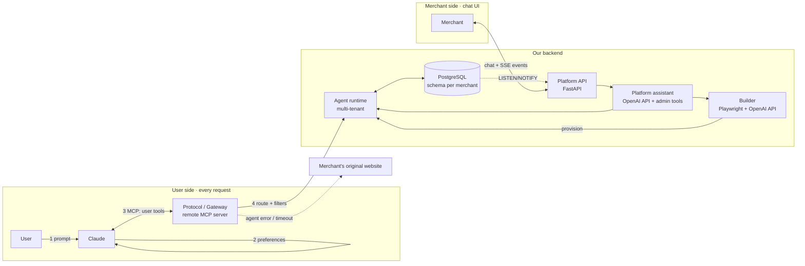

# AGENTS.md — Merchant Agents

> Let Claude book with any merchant, straight from their website.

This file is the single source of truth for this repository. Read it fully before writing code. When something is not specified here, follow **§13 Default decisions** instead of asking, and record any new decision in **§14 Decision log**.

`CLAUDE.md` only imports this file (`@AGENTS.md`), so Claude Code and opencode read the same instructions. Edit this file, never `CLAUDE.md`.

Architecture overview, component boundaries and decision records: [`documentation/ARCHITECTURE.md`](documentation/ARCHITECTURE.md) and [`documentation/adr/`](documentation/adr/README.md).

## 0. Corrections (take precedence over the sections below)

- **All code lives in `code/`** (BaselHack template: `code/`, `documentation/`, `assets/`). The `merchant-agents/` root of §4 is `code/`; run every command of §10 from `code/`.
- **Package `platform` is named `merchant_platform`** (`packages/merchant_platform/src/merchant_platform/`): `platform` is a Python stdlib module and shadows it. Run it with `uv run uvicorn merchant_platform.api:app --port 8002`.
- **MCP Python SDK v2**: `from mcp.server import MCPServer`. `FastMCP` no longer exists in v2; do not copy v1 examples. Behind a tunnel, set `allowed_hosts` or the transport answers 421.
- **`templates/restaurant.json` lives in `agent`** (provisioning consumes it), not in `builder`.
- **Merchant schema name** = `m_` + slug with `-` replaced by `_`; slugs are ≤ 61 characters (Postgres identifiers are limited to 63 bytes).
- **DB access (`core/db.py`, ADR-0001)**: Alembic manages only `public` (migration `0001`). Merchant tables (and the `reservations_notify` trigger) are declared once in SQLAlchemy Core under the placeholder schema `merchant`, so `merchant_metadata.create_all` on a translated connection builds a whole merchant schema; always query them through `merchant_conn(engine, slug)` (`schema_translate_map` → `m_<slug>`) with Core constructs, never `text()`, which is not translated. Turn a slug into a schema only with `schema_for(slug)`. Reservation IDs come from `next_reservation_id(conn)`. SQL changes vs §7.2: `merchants.status` defaults to `building` (`deploy` sets `live`), `notify_reservation()` lives in `public`, is shared by every merchant trigger and also sends `via`; `reservations.during` must not be empty (an empty range would slip past the exclusion constraint).
- **Provisioning (`agent/provisioning.py`)**: `provision(profile)` (one transaction: schema, tables, policy, registry row in `building`), `deploy(slug)` / `set_status(slug, "live"|"down")`, `deprovision(slug)` (idempotent). Each takes an optional keyword `engine=`: long-running processes pass theirs; scripts omit it and get a short-lived engine on `DATABASE_URL`. A slug already in use (or racing another `provision`) raises `SlugTaken` (an `InvalidInput`). After provisioning, the merchant's `tables` and `policy` rows are authoritative; the registry's `profile` jsonb is a display copy that `update_policy` / `update_tables` must keep in sync (#9). `default_tables(seats)` and `generated_tools(profile)` are pure; `templates/restaurant.json` is validated at import (unknown `{placeholder}` = crash at startup).
- **Merchant operations (`agent/admin.py`, #9)**: `PgAgentService.list_reservations` / `get_stats` / `block_slot` / `unblock_slot` / `update_policy` / `update_tables` / `cancel_reservation(by="merchant")` delegate to `agent.admin`, one `merchant_conn` transaction each, so the merchant schema and the registry's `profile` change together. They load the merchant with `merchant_side=True`: a `building` merchant is editable by its owner while hidden from guests. Input outside the database's range is `InvalidInput`, never a raw DB error.
- **MATP, our agent protocol (ADR-0011, `documentation/PROTOCOL.md`)**: TCP on port 4710, one JSON frame per line, `HELLO` with the agent's identity, intent requests typed by `core.models`. The library is `code/packages/matp/` (no dependency beyond `core`, so the gateway can import its client); the node is `code/packages/merchant_node/` (`make node`). Change the protocol in `PROTOCOL.md`, the library and its tests together. The MCP gateway stays as Claude's bridge.
- **Tool contract changes vs §8**: `update_reservation` and `cancel_reservation` also take `guest_name` (checked against the booking); `search_merchants` also returns `suggestions` and `ignored_filters`; admin tool `update_tables` added; table `public.guest_notices` added to the §7.2 SQL; `search_merchants` merchants also carry `website`; `Reservation` also carries `merchant`, `guest_name` and `via`; the admin `cancel_reservation` input has no `by` (the tool is merchant-only, the service receives `by="merchant"`).
- **Gateway (`gateway/`)**: tools take flat typed arguments (same fields and types as the `*Input` models of `core/models.py`) and return `<Result> | ToolError`; only `fallback.py` turns failures into `ToolError`, and arguments the SDK rejects before a tool runs also answer `invalid_input`. `search_merchants` answers `agent_unavailable` + `fallback_url` when its query names a `down` merchant and no live one. Fault injection: `CHAOS_DELAY_MS`, `CHAOS_MERCHANTS`. With `MATP_URL`, the gateway is a bridge to the MATP node; without it, the agent runs in its process (development, tests). Each merchant also has its own endpoint `/m/<slug>/mcp` (`gateway/merchant_server.py`, #23): the 4 booking tools without `merchant`, the slug read from the request path, descriptions from `generated_tools(profile)` rewritten at each `tools/list` (ADR-0012). Details in `documentation/CONTRACTS.md`.
- **Backend LLM calls use OpenAI**, not Anthropic (§14): the builder's `extract` step and the platform assistant use the OpenAI Python SDK (Responses API), with `OPENAI_API_KEY` and `OPENAI_MODEL` (default `gpt-6.1-terra`). The sections below are updated. Claude stays the **user-side** client (Claude.ai connects to the gateway).
- Work is tracked in GitHub issues (milestones M0–M4, Demo); the tracking issue #26 lists every issue and these corrections.

### Team server (LXC)

We have a server: use it to test anything Claude.ai must reach, instead of opening a tunnel.

- **Host:** `root@191.96.88.152`, Ubuntu 24.04. SSH by key only, passwords are refused.
- **SSH key:** `~/.ssh/baselhack2026_lxc` on the user's machine. If it isn't there, **ask the user**, they may have it. Never commit a private key or paste it in a conversation.
  ```bash
  ssh -i ~/.ssh/baselhack2026_lxc -o IdentitiesOnly=yes root@191.96.88.152
  ```
- **Gateway:** `https://191-96-88-152.sslip.io/mcp`, deployed with `make deploy` from `code/`. Code in `/opt/merchant-agents/code`, service `merchant-gateway`, HTTPS by Caddy. Caddy only lets Anthropic's outbound range (`160.79.104.0/21`) through and answers `403` to everyone else (ADR-0010): test with a local gateway, or run the SDK client on the server over SSH against `http://127.0.0.1:8001/mcp`, not with the public URL (SSH port forwarding is disabled on the server). Details in `documentation/runbooks/connector.md`.
- **MATP node:** service `merchant-node` (`code/deploy/merchant-node.service`), installed and restarted by `make deploy` with the gateway, bound to `127.0.0.1:4710` only; the gateway reaches it through `MATP_URL=matp://127.0.0.1:4710`. Port 4710 is never opened without asking (TLS + firewall rule on the shared server). Logs: `journalctl -u merchant-node`.
- **The server is shared, it doesn't only run the gateway.** Ask the user before rebooting it, stopping a service or changing anything outside `/opt/merchant-agents`. When `code/deploy/Caddyfile` changed, `make deploy` validates it, overwrites `/etc/caddy/Caddyfile` and restarts Caddy, so any other site must also be declared there.
- **Firewall (`/etc/nftables.conf`):** only ports 22, 80 and 443 are open inbound, and new outbound connections to private networks are refused. A new service needs a rule there. `fail2ban` bans IPs that repeatedly fail SSH logins.
- **Postgres:** `postgresql-16` on the server, listening on localhost only, database `merchant_agents` (UTF-8), credentials in `/opt/merchant-agents/code/.env`. `make deploy` applies the migrations but doesn't seed. `make outage` and `make seed` act on your local database: for the server's, see the runbook.

---

## 1. What we are building

A merchant (first vertical: **restaurants**) brings **their existing website** and a **short description** of how they work. Our AI reads the site, combines it with the description, and **generates a dedicated agent** for that merchant: its own data (tables, time slots, reservations, policies) and its own **MCP tools**.

Two conversational experiences sit on top:

1. **User side, in Claude.** A user asks Claude: *"Table for 4 tonight at 8pm."* Claude calls our **protocol** (one remote MCP server, added once as a connector). The protocol applies the user's **preferences** as filters, finds the merchant, and routes the call to the merchant's agent, which books. **If the agent fails, the protocol returns a fallback URL to the merchant's original website.**
2. **Merchant side, on our platform.** The merchant manages everything **by chatting with a platform assistant**: onboarding (give the URL, describe the business, the agent gets built), then day-to-day operations (*"What bookings do I have tonight?"*, *"Block 21:00 tonight"*, *"Set max party size to 6"*, *"Cancel R-001"*). New bookings made through Claude show up **live** in the merchant's conversation.

There is **no form-based UI** on either side: everything is a conversation. Structured results (booking card, reservations table, agent profile) are rendered as rich messages inside the chat.

## 2. Glossary

| Term | Meaning |
|---|---|
| **Protocol / Gateway** | The public remote MCP server Claude connects to. Discovery, preference filtering, routing, fallback. |
| **Merchant agent** | The per-merchant booking logic and data. Logically one per merchant; physically one multi-tenant service in the POC (§13). |
| **Builder** | Pipeline that turns *website + description* into a validated `MerchantProfile`, then provisions the agent. |
| **Platform assistant** | The LLM assistant merchants chat with on our platform. Uses admin tools on the merchant's agent. |
| **MerchantProfile** | Validated JSON describing a merchant (§7.1). Single input to provisioning. |
| **Fallback URL** | Link to the merchant's own booking page, returned whenever the agent can't serve a request. |

## 3. Architecture



Request numbering matches the design canvas ("Architecture" page): runtime steps **1–6**, onboarding steps **A–C**.

## 4. Repository layout

```
merchant-agents/
├── CLAUDE.md                  ← this file
├── README.md                  ← how to run, short
├── docker-compose.yml         ← postgres + services
├── pyproject.toml             ← uv workspace
├── .env.example
├── packages/
│   ├── core/                  ← shared: models, DB, availability logic, errors
│   │   └── src/core/
│   │       ├── models.py          (Pydantic: MerchantProfile, Slot, Reservation, …)
│   │       ├── db.py              (SQLAlchemy engine, schema-per-merchant helpers)
│   │       ├── availability.py    (pure functions, no I/O)
│   │       └── errors.py          (error codes, §8.4)
│   ├── agent/                 ← agent runtime: booking + admin operations per merchant
│   │   └── src/agent/
│   │       ├── service.py         (AgentService: create/update/cancel/list/block/…)
│   │       └── provisioning.py    (MerchantProfile → schema + rows)
│   ├── gateway/               ← public remote MCP server (FastMCP, Streamable HTTP)
│   │   └── src/gateway/
│   │       ├── server.py          (user tools, §8.1)
│   │       ├── discovery.py       (search + preference filtering)
│   │       └── fallback.py        (timeouts, error → fallback_url)
│   ├── builder/               ← website + description → MerchantProfile
│   │   └── src/builder/
│   │       ├── crawl.py           (Playwright)
│   │       ├── extract.py         (OpenAI API, strict function call)
│   │       └── templates/restaurant.json
│   └── platform/              ← merchant platform API + assistant
│       └── src/platform/
│           ├── api.py             (FastAPI: /chat, /events SSE)
│           ├── assistant.py       (OpenAI API tool-use loop, admin tools §8.2)
│           └── events.py          (Postgres LISTEN/NOTIFY → SSE)
├── web/                       ← merchant chat UI (Vite + React + TS)
├── migrations/                ← Alembic
└── tests/
    ├── unit/
    ├── integration/
    └── e2e/                   ← scripted demo scenario, §11
```

## 5. Stack (fixed for the POC)

| Area | Choice | Why | Rejected |
|---|---|---|---|
| Language | **Python 3.12**, managed with **uv** | Most mature MCP SDK; Playwright and OpenAI SDK in the same language; fast iteration. | Go/Rust gateway — revisit only if latency/load require it. |
| MCP | Official **`mcp` SDK (FastMCP)**, **Streamable HTTP** transport | Claude supports remote MCP servers as connectors; no custom client. | Custom REST API re-exposed as tools. |
| API | **FastAPI** + **Pydantic v2** | Typed schemas shared with MCP tools; native SSE support via streaming responses. | Flask, Django. |
| DB | **PostgreSQL 16**, **SQLAlchemy 2.0**, **Alembic** | `EXCLUDE` constraint on time ranges makes double booking impossible; `LISTEN/NOTIFY` gives live events for free. | SQLite (no exclusion constraint, weak concurrency). |
| Crawl | **Playwright** (Chromium) | Handles JS-rendered restaurant sites. | requests + BeautifulSoup (misses JS content). |
| LLM | **OpenAI Python SDK** (Responses API), model from env `OPENAI_MODEL` | Structured extraction via a forced strict function call; platform assistant via tool-use loop. | Anthropic SDK (§14: the team's key is an OpenAI one). |
| Live events | Postgres **LISTEN/NOTIFY → SSE** | No extra broker; one-way server→client is all we need. | Redis pub/sub, WebSockets (unneeded complexity). |
| Front | **Vite + React + TypeScript** | Minimal chat UI with rich message components. | Next.js (SSR not needed). |
| Tests | **pytest**, **pytest-asyncio**, **testcontainers** (Postgres) | Real Postgres in tests: the exclusion constraint must be tested for real. | Mocked DB. |
| Lint/format | **ruff** (lint + format), **mypy --strict** on `core` | | |

## 6. Domain rules (restaurant vertical)

- A reservation occupies its table for **120 minutes** (`SLOT_LENGTH_MIN`, configurable per merchant later).
- Bookable start times: every **30 min** within each service, **last seating = service end − 60 min**.
- Table assignment: smallest table with `seats >= party_size` that has **no overlapping reservation** and whose start time is **not blocked**.
- `party_size > max_party_size` → error `party_too_large` + `fallback_url`.
- Availability search returns up to **3 slots**, closest to the requested time, sorted by time.
- **Every write initiated from Claude requires explicit user confirmation** in the conversation before `create_reservation` / `update_reservation` / `cancel_reservation` is called. This is enforced by tool descriptions (instructing Claude to confirm) and by the protocol requiring an `idempotency_key`.
- A merchant cancelling a booking must **notify the guest** (POC: stored notice surfaced on the user's next `get_my_reservations`; see §13).
- Blocking a slot never removes existing bookings; it only prevents new ones at that start time.

## 7. Data model

### 7.1 MerchantProfile (output of the builder, input of provisioning)

```json
{
  "$schema": "https://json-schema.org/draft/2020-12/schema",
  "title": "MerchantProfile",
  "type": "object",
  "required": ["slug", "name", "website", "vertical", "seats", "services", "max_party_size", "tables", "tags", "price_level", "fallback_url"],
  "properties": {
    "slug":            { "type": "string", "pattern": "^[a-z0-9-]{3,63}$" },
    "name":            { "type": "string" },
    "website":         { "type": "string", "format": "uri" },
    "vertical":        { "const": "restaurant" },
    "location":        { "type": "object", "properties": { "city": { "type": "string" }, "lat": { "type": "number" }, "lng": { "type": "number" } } },
    "seats":           { "type": "integer", "minimum": 1 },
    "services":        { "type": "array", "minItems": 1, "items": { "type": "object", "required": ["start", "end"], "properties": { "start": { "type": "string", "pattern": "^\\d{2}:\\d{2}$" }, "end": { "type": "string", "pattern": "^\\d{2}:\\d{2}$" } } } },
    "max_party_size":  { "type": "integer", "minimum": 1 },
    "tables":          { "type": "array", "items": { "type": "object", "required": ["label", "seats"], "properties": { "label": { "type": "string" }, "seats": { "type": "integer", "minimum": 1 } } } },
    "tags":            { "type": "array", "items": { "enum": ["gluten-free", "vegetarian", "vegan", "halal", "kosher", "terrace", "kid-friendly"] } },
    "price_level":     { "enum": ["€", "€€", "€€€", "€€€€"] },
    "cancellation_policy": { "type": "string" },
    "fallback_url":    { "type": "string", "format": "uri" }
  }
}
```

The LLM **only fills this schema**. It never generates code, SQL or tool definitions. Provisioning is deterministic code driven by the profile and `templates/restaurant.json`.

### 7.2 SQL (one schema per merchant, plus a shared `public` registry)

```sql
-- public schema: registry used by discovery
CREATE TABLE public.merchants (
  id            uuid PRIMARY KEY DEFAULT gen_random_uuid(),
  slug          text UNIQUE NOT NULL,
  name          text NOT NULL,
  website       text NOT NULL,
  fallback_url  text NOT NULL,
  city          text,
  tags          text[] NOT NULL DEFAULT '{}',
  price_level   text NOT NULL,
  status        text NOT NULL DEFAULT 'live' CHECK (status IN ('building','live','down')),
  profile       jsonb NOT NULL,          -- the validated MerchantProfile
  created_at    timestamptz NOT NULL DEFAULT now()
);

-- per-merchant schema: m_<slug>
CREATE EXTENSION IF NOT EXISTS btree_gist;

CREATE TABLE tables (
  id     serial PRIMARY KEY,
  label  text UNIQUE NOT NULL,
  seats  int  NOT NULL CHECK (seats > 0)
);

CREATE TABLE policy (
  id               int PRIMARY KEY DEFAULT 1 CHECK (id = 1),
  max_party_size   int NOT NULL,
  slot_length_min  int NOT NULL DEFAULT 120,
  services         jsonb NOT NULL          -- [{ "start": "19:00", "end": "22:00" }]
);

CREATE TABLE blocked_slots (
  starts_at  timestamptz PRIMARY KEY
);

CREATE TABLE reservations (
  id               text PRIMARY KEY,       -- human ref, e.g. R-001
  table_id         int  NOT NULL REFERENCES tables,
  guest_name       text NOT NULL,
  party_size       int  NOT NULL CHECK (party_size > 0),
  during           tstzrange NOT NULL,
  via              text NOT NULL CHECK (via IN ('claude','merchant','website')),
  status           text NOT NULL DEFAULT 'confirmed' CHECK (status IN ('confirmed','cancelled')),
  cancelled_by     text CHECK (cancelled_by IN ('guest','merchant')),
  idempotency_key  text UNIQUE,
  created_at       timestamptz NOT NULL DEFAULT now(),
  EXCLUDE USING gist (table_id WITH =, during WITH &&) WHERE (status = 'confirmed')
);

-- live events for the merchant platform
CREATE OR REPLACE FUNCTION notify_reservation() RETURNS trigger AS $$
BEGIN
  PERFORM pg_notify('reservations', json_build_object(
    'schema', TG_TABLE_SCHEMA, 'op', TG_OP, 'id', NEW.id, 'status', NEW.status)::text);
  RETURN NEW;
END $$ LANGUAGE plpgsql;

CREATE TRIGGER reservations_notify AFTER INSERT OR UPDATE ON reservations
FOR EACH ROW EXECUTE FUNCTION notify_reservation();
```

## 8. Tool contracts

All tool inputs/outputs are Pydantic models in `core/models.py`; JSON shown for readability. Times are ISO 8601 with the merchant's timezone (POC: `Europe/Zurich`).

### 8.1 User tools — exposed by the **gateway** to Claude

| Tool | Input | Output |
|---|---|---|
| `search_merchants` | `{ query: str, near?: str, date?: str, filters?: { tags?: str[], max_price?: str } }` | `{ merchants: [{ slug, name, city, tags, price_level }] }` |
| `get_availability` | `{ merchant: str, date: str, time?: "HH:MM", party_size: int }` | `{ slots: [{ starts_at, table_label }] }` (≤ 3) |
| `create_reservation` | `{ merchant, starts_at, party_size, guest_name, idempotency_key }` | `{ reservation: { id, starts_at, party_size, table_label, status } }` |
| `update_reservation` | `{ merchant, reservation_id, starts_at?, party_size?, idempotency_key }` | `{ reservation }` |
| `cancel_reservation` | `{ merchant, reservation_id }` | `{ status: "cancelled" }` |
| `get_my_reservations` | `{ guest_name }` | `{ reservations: [...], notices: [str] }` |

Tool descriptions must tell Claude: *confirm with the user before any create/update/cancel; pass the user's dietary/budget preferences as `filters`; if a result contains `fallback_url`, give it to the user.*

### 8.2 Admin tools — used by the **platform assistant** (merchant side, never exposed to Claude users)

| Tool | Input | Output |
|---|---|---|
| `build_agent` | `{ website: str, description: str }` | `{ profile: MerchantProfile, status: "live" }` (streams step events) |
| `list_reservations` | `{ date: str }` | `{ reservations: [{ id, time, guest_name, party_size, table_label, via }] }` |
| `get_stats` | `{ date: str }` | `{ bookings: int, guests: int, seats: int, blocked: [str] }` |
| `block_slot` / `unblock_slot` | `{ starts_at }` | `{ ok: true }` |
| `update_policy` | `{ max_party_size?: int, services?: [...] }` | `{ policy }` |
| `cancel_reservation` | `{ reservation_id, by: "merchant" }` | `{ status: "cancelled" }` — also creates a guest notice |

### 8.3 Builder steps (emitted as events, shown in the merchant chat)

1. `crawl` — Playwright loads the site (homepage + up to 5 same-domain pages whose path or link text matches `menu|carte|karte|hours|horaires|zeiten|contact|kontakt|book|reserv`).
2. `extract` — OpenAI API fills `MerchantProfile` (forced strict function call with the JSON schema as `parameters`), using crawled text + merchant description. Description wins on conflicts.
3. `validate` — Pydantic validation; on failure, one retry with the validation errors fed back; then fail with a message to the merchant.
4. `provision` — create schema `m_<slug>`, tables, policy, registry row.
5. `deploy` — mark `status = 'live'`; the merchant is now discoverable by the gateway.

### 8.4 Errors

Every tool error is `{ "error": <code>, "message": str, "fallback_url"?: str }`.

| Code | When | `fallback_url` |
|---|---|---|
| `agent_unavailable` | Agent timeout (> **2 s**) or exception, or merchant `status = 'down'` | yes |
| `party_too_large` | `party_size > max_party_size` | yes |
| `slot_unavailable` | Slot taken (incl. exclusion-constraint violation) or blocked | no |
| `not_found` | Unknown merchant / reservation | no |
| `invalid_input` | Validation error | no |

## 9. Conversations to support (acceptance scenarios)

**User ↔ Claude (via gateway)**
- "Table for 4 tonight at 8pm" → `search_merchants` with preference filters → `get_availability` → Claude proposes slots → user picks → Claude asks to confirm → `create_reservation` → booking card.
- "Move it to 9pm" → `update_reservation`. "Cancel my booking" → `cancel_reservation`.
- Vegan preference on, merchant not tagged vegan → no match, Claude offers to drop the filter.
- "Table for 8" when max is 6 → `party_too_large` → Claude gives the fallback link.
- Agent down → `agent_unavailable` → Claude gives the fallback link.

**Merchant ↔ platform assistant**
- Onboarding: assistant asks for the website → asks for the description → calls `build_agent` → shows step progress → shows the agent profile card.
- "What bookings do I have tonight?" → `list_reservations` → table message.
- "Block 21:00 tonight" → `block_slot`; Claude users no longer get 21:00.
- "Set max party size to 6" → `update_policy`.
- "How busy are we tonight?" → `get_stats`.
- "Cancel R-001" → `cancel_reservation(by="merchant")` → guest notice created.
- A booking made through Claude appears in the merchant chat as a **"New booking via Claude"** notification within 2 s (SSE).

## 10. Commands

```bash
uv sync                                   # install
docker compose up -d db                   # Postgres 16
uv run alembic upgrade head               # migrations
uv run python -m gateway                  # MCP server  → http://localhost:8001/mcp
uv run uvicorn platform.api:app --port 8002
cd web && npm i && npm run dev            # merchant chat UI → http://localhost:5173
uv run pytest                             # all tests (testcontainers starts Postgres)
uv run ruff check . && uv run ruff format --check . && uv run mypy packages/core packages/agent packages/gateway packages/matp packages/merchant_node
npx @modelcontextprotocol/inspector       # manual MCP testing against :8001/mcp
```

Env (`.env.example`): `DATABASE_URL`, `OPENAI_API_KEY`, `OPENAI_MODEL`, `MERCHANT_TZ=Europe/Zurich`, `AGENT_TIMEOUT_MS=2000`, `GATEWAY_PUBLIC_URL`.

## 11. Milestones (each ends green on its tests)

**M1 — Core + agent runtime**
- `core/availability.py` as pure functions; unit tests for slot generation, table choice, blocked slots, last seating.
- Provisioning from a hand-written `MerchantProfile` fixture (`tests/fixtures/le-petit-zinc.json`).
- Integration test: **two concurrent `create_reservation` on the same table/slot → exactly one succeeds** (real Postgres).

**M2 — Gateway (user side)**
- FastMCP server with §8.1 tools, preference filtering, 2 s timeout, error mapping §8.4.
- Tested with MCP Inspector; e2e test calling tools through an MCP client.
- Connected to Claude as a custom connector (needs `GATEWAY_PUBLIC_URL`, e.g. via a tunnel); manual run of the §9 user scenarios.

**M3 — Platform assistant + live events (merchant side)**
- FastAPI `/chat` running an OpenAI tool-use loop with §8.2 admin tools; `/events` SSE fed by `LISTEN/NOTIFY`.
- Web chat UI rendering rich messages: steps, profile card, reservations table, notifications.

**M4 — Builder**
- Crawl + extraction + validation + provisioning, streamed as steps into the merchant chat.
- Demo on **3 real restaurant websites**; store their generated profiles as fixtures.

**Definition of done (POC):** the full §9 scenario list runs end to end — merchant onboards by chat, user books from Claude, merchant sees it live and blocks a slot, outage triggers fallback.

## 12. Conventions

- Business logic lives in `core` and `agent` as **plain functions/classes**; MCP and HTTP layers are thin adapters.
- No raw SQL string building from user input; parameterized queries only. Schema names come from validated slugs.
- Every tool validates input with Pydantic and returns §8.4 errors, never stack traces.
- Log every tool call (tool, merchant, latency, outcome) as structured JSON; never log guest names at INFO level.
- Tests first for `availability.py` and anything touching the exclusion constraint.
- Commits: Conventional Commits (`feat:`, `fix:`, `test:` …), one milestone per branch/PR.
- **Living docs, same PR as the code**: update `documentation/ARCHITECTURE.md` when you add, rename or remove a component, change the main flow, the stack, a protocol or data format, or a guarantee (§4 Components, §3 Main flow, §5 Stack, §6 Invariants, §7 Glossary). A new or replaced technology or a structural choice gets a new ADR in `documentation/adr/` (never edit an accepted one: supersede it). A local fix, a rename of a variable or an extra test needs neither.
- Everything in the repo is in **English**: code, comments, docs, commits, PRs, issues. Only the demo site's content is in French.

## 13. Default decisions (apply without asking)

- **One agent per merchant** is a logical boundary: implemented as one multi-tenant `AgentService` keyed by merchant slug, data isolated by Postgres schema. No per-merchant processes in the POC.
- **Gateway and agent runtime** run in the same process in the POC, behind an `AgentClient` interface so they can be split later.
- **Auth:** none in M1–M2 local dev; for the Claude connector in M2, add OAuth 2.1 (as the MCP spec describes) only if the connector requires it, otherwise a static bearer token via env. Merchant platform: single hard-coded merchant session in the POC.
- **Guest identity:** the `guest_name` Claude passes; no accounts.
- **Guest notices** (merchant cancellations): stored per guest name and returned by `get_my_reservations`; no push to Claude.
- **Fallback depth:** return the URL only; Claude does not drive the website.
- **Timezone:** `Europe/Zurich` everywhere; store `timestamptz`.
- **Location/discovery:** single city, filter by tags and price only; no ranking beyond name order.
- **Preferences** are never stored server-side; they only arrive as `filters`.
- Missing info in a merchant description → use template defaults (`slot_length_min=120`, `max_party_size=8`, services `19:00–22:00`) and tell the merchant in chat what was assumed.

## 14. Decision log

| Date | Decision | Reason |
|---|---|---|
| 2026-10-31 | Python + FastMCP + Postgres + FastAPI + Vite/React | See §5 |
| 2026-10-31 | LLM fills a schema, never writes code | Safety, determinism (§7.1) |
| 2026-10-31 | Both sides are chat-only | Product principle (§1) |
| 2026-10-31 | Code in `code/`, `platform` → `merchant_platform`, MCP SDK v2 (`MCPServer`) | BaselHack template; stdlib name clash; FastMCP removed in v2 (§0) |
| 2026-10-31 | Claude API for every LLM call (OpenAI not used) | One SDK; a multi-provider layer costs time for no demo gain |
| 2026-10-31 | `AGENTS.md` is the shared instruction file, `CLAUDE.md` imports it | Team uses both Claude Code and opencode |
| 2026-10-31 | Freeze `core/models.py`, the `AgentService` protocol and `web/src/types.ts` in #2; later contract changes need a dedicated PR and team announcement | Unblock parallel backend and frontend work |
| 2026-10-31 | Require `guest_name` on guest updates and cancellations | A reservation reference alone is not guest identity |
| 2026-10-31 | Discovery returns `suggestions` and `ignored_filters`; search tags accept unknown strings | Let Claude explain unsupported filters and propose relaxing preferences |
| 2026-10-31 | `BuildAgentOutput` includes `assumptions`, `tools` and `mcp_url`; admin tools include `UpdateTablesInput` | Populate the profile card and allow table-plan corrections during onboarding |
| 2026-10-31 | Optional profile/location fields default to `None`; card JSON includes nulls; `HHMM` validates real 24-hour clock values | Keep Python/TS outputs aligned and reject impossible times at the boundary |
| 2026-10-31 | Contract models use tuples, reject blank identity fields, invalid floor plans, overlapping or sub-hour services and no-op updates; SSE events are also Pydantic models | Deep immutability, no empty guest identity, errors caught at the `validate` step, Python/TS drift caught by the mocks |
| 2026-10-31 | `max_party_size` may exceed the largest table and `seats` may differ from the tables' total; the service raises `PartyTooLarge` when no table fits | Template default and #10 fixtures rely on it; #7 trusts `tables`; the guest still gets the fallback URL |
| 2026-10-31 | Gateway stays on MCP SDK v2 (`mcp` 2.3.0), no fallback to v1 | Spike #3: works from Claude.ai, Claude Code and the SDK client (`documentation/runbooks/connector.md`) |
| 2026-10-31 | `GATEWAY_TOKEN` is optional; public URL = team LXC behind Caddy (`https://191-96-88-152.sslip.io/mcp`), ngrok as documented alternative; gateway binds `127.0.0.1` | Static header auth on Claude.ai connectors is a beta for limited organizations; fixed URL independent of a laptop and of hackathon Wi-Fi; only Caddy reaches the gateway |
| 2026-10-31 | OpenAI API for every backend LLM call (replaces the "Claude API" row above) | The team's API key is an OpenAI one; still one SDK. Spike #4 validated strict function calling for the extraction |
| 2026-10-31 | Platform assistant (#17) on the OpenAI Responses API behind an `LLMClient` interface; history stored in a provider-neutral format, `store=False`; reasoning effort `low` by default | Same provider as the builder; the loop and its tests don't depend on OpenAI types; nothing kept on OpenAI's side; first words fast in a chat |
| 2026-10-31 | Until the builder lands (#22), `build_agent` provisions the Le Petit Zinc fixture while emitting the five steps; `PLATFORM_MERCHANT` starts the chat as an existing merchant | Onboarding demoable end to end now; a page reload or a seeded demo doesn't force a new onboarding |
| 2026-10-31 | Builder (#22): the LLM fills a `ProfileDraft` (no slug, website, vertical; tags as free strings; tables may be empty) through a forced `save_merchant_profile` call; the code sets slug (suffix `-2`, `-3`… when taken), website, vertical, filters tags, keeps `fallback_url` on the merchant's host (else the crawled booking page, else the homepage), fills a missing floor plan with `default_tables` and aligns `seats` with the tables, each default announced as an assumption | §7.1: the LLM only fills a schema; the code owns identity, links and the floor plan; a strict `MerchantProfile` schema would reject what the code is meant to fix |
| 2026-10-31 | `llm.py` (the `LLMClient` interface and its OpenAI client) lives in `builder`, used by the builder and the platform assistant; `tool_choice` forces a tool; the builder's extraction uses `BUILDER_REASONING_EFFORT` (default `none`, spike #4) | `merchant_platform` depends on `builder`, not the reverse; `builder` already depends on `openai`, so no new dependency |
| 2026-10-31 | A website that already has a live (or down) agent is refused by `build_agent` before any step; only for `PLATFORM_MERCHANT` does the platform attach the session to it so the assistant offers to update it; a build stopped before `deploy` is deprovisioned; generated profiles go to `code/.cache/builder/generated/`; the #17 fixture stub is removed | No duplicate agents; without authentication, typing someone's URL must not hand over their bookings; no half-built merchant blocks a site; builds never write into the source tree |
| 2026-10-31 | One Postgres schema per merchant, tables declared once in Core and translated per merchant; no migrations for merchant schemas (drop + re-provision) | Structural isolation, per-merchant exclusion constraint and sequence, no SQL built from slugs ([ADR-0001](documentation/adr/0001-one-postgres-schema-per-merchant.md)) |
| 2026-10-31 | Keep the name "Le Petit Zinc" (slug `le-petit-zinc`): the site uses a fictional address and says on every page that the restaurant is fictional | A bistro of that name existed in Mulhouse (15 rue des Bons Enfants) but is listed as closed; renaming would touch every team's fixtures and mocks |
| 2026-10-31 | The public gateway URL only accepts Anthropic's outbound range `160.79.104.0/21` (Caddy `remote_ip`, `403` otherwise) | Claude.ai can't send `GATEWAY_TOKEN` without the header-auth beta; the write tools (#11) must not be open to anyone ([ADR-0010](documentation/adr/0010-allow-only-anthropics-outbound-range-on-the-public-gateway.md)) |
| 2026-10-31 | La Graine Verte and Maison Albane have one-page sites on :8081 and :8082 (`make sites`); their `fallback_url` is the page's `#reserver` section | Their fallback link opens a real page in the demo, next to Le Petit Zinc on :8080 |
| 2026-10-31 | `search_merchants` answers `agent_unavailable` + `fallback_url` when the query names a `down` merchant and no live one (#11, #13) | `search` hides `down` merchants and treats a query naming none as generic, so "a table at Le Petit Zinc" during an outage would propose other restaurants instead of the fallback link (§9) |
| 2026-10-31 | Tools declare typed arguments; a small MCP middleware turns what the SDK rejects into `invalid_input` | Claude sees the full schema (slug pattern, formats, price enum); every failure keeps the §8.4 shape and its log line. The SDK calls that middleware API provisional: tests pin it |
| 2026-10-31 | Per-merchant endpoints `/m/<slug>/mcp` come from one second `MCPServer` routed by the path, not one instance per merchant; the profile card derives the URL from `mcp_url` (#23) | A merchant deployed after startup needs no restart and its descriptions follow `update_policy`; no change to the frozen `BuildAgentOutput` ([ADR-0012](documentation/adr/0012-one-mcp-server-for-every-merchant-endpoint.md)) |
| 2026-10-31 | As a bridge, the gateway keeps reading the registry itself for the `down` status and the fallback URL, and `search_merchants` gives the link of a merchant its query names when `DISCOVER` fails (#61) | A dead node must not leave the user without the restaurant's link, which is the protocol's promise (§1) |
| 2026-10-31 | Postgres installed on the team server (localhost only), and `make deploy` applies the migrations | Claude.ai reaches the gateway only through the server, and the tools need their data there. The demo's other pieces (#25) can share it through the server or an SSH tunnel |
| 2026-10-31 | Booking writes lock the table's row (`SELECT … FOR UPDATE`) inside each SAVEPOINT before inserting or moving a reservation (#8) | Without it, concurrent writers checking the exclusion constraint wait on each other's uncommitted rows and deadlock (`40P01`, ~1 s each). The lock only queues writers per table; the constraint stays what prevents double booking (with the lock but without the constraint, 10 concurrent bookings all succeed) |
| 2026-10-31 | A booking re-reads its table's seats under the table lock in `_attempt`; a removed or too small table counts as taken (#9) | `update_tables` can change the plan between `_load` and the write; without the re-check a party of 4 could land on a table shrunk to 2, or hit a foreign-key error |
| 2026-10-31 | `update_tables` refuses to remove a table that past or cancelled bookings refer to; no `active` flag on `tables` | The foreign key keeps the booking history; floor-plan corrections happen during onboarding, before any booking. An `active` flag would need a merchant-schema change and filtering in `_load` |
| 2026-10-31 | `update_policy` returns no warning about existing bookings above a lowered `max_party_size` | `Policy` is a frozen contract without such a field; the assistant can call `list_reservations` |
| 2026-10-31 | The crawler checks every browser request after DNS resolution, follows redirects itself hop by hop and never lets the browser follow one (each page's redirects are resolved before loading it); it never loads WebSockets, images, fonts or media; link-local addresses (169.254.169.254) stay refused with `CRAWL_ALLOW_PRIVATE=1`; DNS rebinding is not covered | Chromium doesn't route redirect hops, so a public page could otherwise reach the team server's local services, even by answering the check and the browser differently; only text is read (#21) |
| 2026-10-31 | The crawl's link filter (§8.3) also matches German (`karte`, `zeiten`, `kontakt`), accents ignored; crawl failures are `InvalidInput` with the message shown in the `crawl` step | Most Basel restaurant sites are in German (tested on kronenhalle.com); the merchant can fix the address (#21) |
| 2026-10-31 | Extraction prompt `v2.2` (#74): price bands from the typical main or menu price, CHF counted like EUR; services are the kitchen hours when given, else the opening hours; `max_party_size` is the largest party that can book without being asked to call, whatever the channel (a form's maximum doesn't count); a one-page site's homepage fallback gets its booking section (`#reserv…`/`#book…`) from the crawled element ids. Le Petit Zinc's site now says "en ligne jusqu'à 6 personnes" and keeps its 1–12 form | Measured on `gpt-6.1-terra`, 5 runs per site (`scripts/bench_extract.py`): La Graine Verte's price was `€€` 3/5, every phone-only group limit fell back to 8, both one-page fallbacks landed at the top of the page. The form still demonstrates `party_too_large` |
| 2026-10-31 | Weekly closing days, minimum fix (#73): the LLM fills `closed_days` in `ProfileDraft` (prompt `v2.3`), and the code turns them into the assumption "Closed on Sunday: the agent can't skip a weekday yet, so Sunday bookings stay open." `Service` keeps no weekdays | The full fix changes the frozen `core/models.py` and `web/src/types.ts` (dedicated PR). The demo restaurants are open every day; a real onboarding (restaurant-kunsthalle.ch, closed on Sunday) now tells the merchant instead of silently taking Sunday bookings. The sentence is the code's, so it is the same in every run and testable without a model |

## 15. Out of scope (POC)

Payments/deposits/no-show fees · other verticals · sync with existing booking/POS software · merchant ownership verification · multi-city discovery and ranking · mobile apps · i18n beyond English UI.

## 16. Open questions (do not block on these; use §13 meanwhile)

- How to rank merchants when many match (distance, availability, preferences)?
- How to verify that the person onboarding owns the website?
- Merchants already on a booking tool: integrate it, or make our DB the source of truth?
- Should Claude complete the website flow itself on fallback (browser) instead of returning a link?
- One template per vertical, or a generic template?
- Business model: per booking, subscription, or free at first?

## 17. Reference: interactive prototype

The design canvas *Merchant agents* (pages **Overview**, **Architecture**, **POC**) contains a clickable prototype of both conversations. It simulates the crawl, the extraction and both assistants, but implements the real availability rules of §6. Use it as the UX reference for message types and wording; this file is the reference for behaviour.
