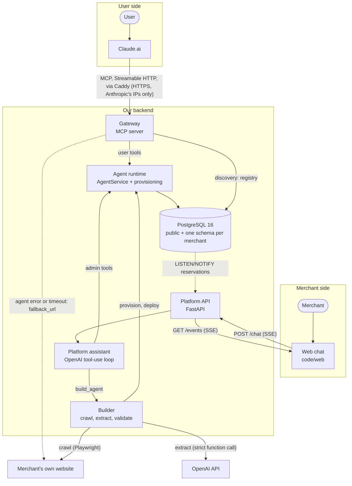
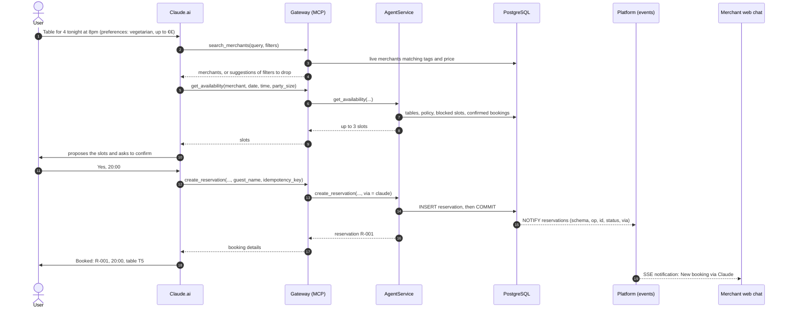

# Sésame — Architecture

> Living document: update it **in the same PR** as the code that makes it wrong.
> Decisions and their reasons are in [`adr/`](adr/README.md); the full spec is [`AGENTS.md`](../AGENTS.md).

## 1. In one sentence

A restaurant owner gives us their website and a short description. We generate a booking agent for that restaurant, so that anyone can book a table by asking Claude, and the owner manages everything by chatting with our platform.

## 2. Overview

**Two conversations, one agent per merchant:**
- **User side.** Claude calls our **gateway**, a remote MCP server added once as a connector. The gateway applies the user's preferences as filters, routes the call to the merchant's agent, and returns the merchant's own booking page (`fallback_url`) when the agent cannot serve the request.
- **Merchant side.** The merchant chats with the **platform assistant**. It builds the agent from the website (the **builder**), then runs day-to-day operations through admin tools: "What bookings do I have tonight?", "Block 21:00". New bookings from Claude appear live in the chat.

**What "agent" means here.** The merchant's agent is not an AI and not a separate process. It is the restaurant's data (tables, hours, policy, bookings) in its own Postgres schema `m_<slug>`, plus the booking tools described for Claude, all served by one shared multi-tenant `AgentService` ([ADR-0001](adr/0001-one-postgres-schema-per-merchant.md)). The only LLMs are:
- Claude, on the user side;
- the builder's extraction step;
- the merchant assistant.

## 3. Main flow: Claude books, the merchant sees it live

> **Status:** this section describes the target flow.
> - **Built:**
>   - the data layer: `core/db.py`, `core/availability.py`, provisioning, and the trigger that sends `NOTIFY`;
>   - the `AgentService` on Postgres: Claude-side bookings (#8) and merchant operations (#9);
>   - the platform API, with the `/chat` and `/events` streams and the public booking API (#15);
>   - the live-event listener (#18);
>   - the merchant assistant (#17) and the builder it calls (#21, #22);
>   - the web chat;
>   - the demo data and the three demo websites (#10, #16);
>   - the gateway's user tools, discovery and timeout/fallback layer (#11, #12, #13, #14).
>
> Claude reaches the agent through the gateway. Live notifications still need the platform on the gateway's Postgres: see the open question on the demo topology (#25).
>
> §4 gives the state of each component.

**Step by step:**

1. **Request (1).** The user asks Claude in plain language. Their dietary and budget preferences come from Claude's side; we never store them (invariant 5).
2. **Discovery (2–4).** `search_merchants` reads the registry `public.merchants`. Only merchants with status `live` are returned, filtered by tags and price. If nothing matches, the response suggests which filter to drop and how many merchants that would add (`suggestions`), so Claude can offer it to the user ([ADR-0008](adr/0008-deviations-from-the-original-tool-contracts.md)).
3. **Availability (5–9).** The `AgentService` reads the merchant's schema through `merchant_conn(engine, slug)`. The pure functions in `core/availability.py` compute up to 3 start times closest to the request. Starts are every 30 minutes, the last seating is 60 minutes before the end of the service, and blocked starts are excluded. Each slot gets the smallest free table that fits.
4. **Confirmation (10–11).** Claude must confirm with the user before any write. The tool descriptions instruct it to (invariant 2).
5. **Booking (12–14).** `create_reservation` carries an `idempotency_key`, so a retried call does not book twice. The insert either succeeds or is rejected by the database's exclusion constraint if the table is already taken at that time (invariant 1). The reference `R-NNN` comes from the merchant's own sequence.
6. **Live event (15, 19).** Inside the booking's transaction, an `AFTER INSERT` trigger on the merchant's `reservations` table calls `public.notify_reservation()`, which queues `NOTIFY reservations`. Postgres delivers it when the transaction commits. The platform listens on that channel and pushes a `LiveEvent` over SSE to the merchant's open chat: "New booking via Claude". The target is under 2 s (#18).
7. **Answer (16–18).** Claude shows the booking to the user.

**When something fails:**
- A party larger than `max_party_size`, or one that no table can seat, gets `party_too_large`.
- An unreachable or slow agent (over 2 s), or a merchant marked `down`, gets `agent_unavailable`.

In both cases the error carries the merchant's `fallback_url`, and Claude gives the user that link. A taken slot gets `slot_unavailable`, with no link.

## 4. Components

Paths are relative to `code/`.

| Component | File | Responsibility | Does NOT do | State |
|---|---|---|---|---|
| Contracts | `packages/core/src/core/models.py`, `errors.py`, `packages/agent/src/agent/service.py`, `web/src/types.ts` | Tool inputs/outputs, SSE events, business errors, the async `AgentService` protocol ([CONTRACTS.md](CONTRACTS.md)) | No I/O, no business logic; never change without a dedicated PR | ✅ #2 |
| Settings | `packages/core/src/core/config.py` | Typed settings from the environment and `code/.env`; `DATABASE_URL` required | No defaults for secrets | ✅ #1 |
| Availability rules | `packages/core/src/core/availability.py` | Pure functions: bookable start times, table choice, slot search (up to 3) | No database access; never reads the clock (`now` is passed in) | ✅ #5 |
| DB layer | `packages/core/src/core/db.py`, `migrations/versions/0001_public_schema.py`, `0002_reservation_changes.py` | Engine; `schema_for(slug)`; merchant tables declared once, with the exclusion constraint, the notify trigger, and a trigger that skips updates that change nothing (an idempotent replay sends no notification); `merchant_conn` (one transaction, schema translation); registry, guest notices and the keys of applied updates in `public` | No business rules; no migrations for merchant schemas (drop + re-provision) | ✅ #6 |
| Provisioning | `packages/agent/src/agent/provisioning.py`, `packages/agent/src/agent/templates/restaurant.json` | `MerchantProfile` → merchant schema, floor plan, policy, registry row (all or nothing); `deploy` / `set_status` / `deprovision`; default floor plan; generated tool descriptions | Never calls an LLM, never builds SQL from profile text, never takes bookings | ✅ #7 |
| Agent service | `packages/agent/src/agent/service.py` (`PgAgentService`), `admin.py` | Claude-side bookings: availability, create, update, cancel. Each candidate table is tried in its own SAVEPOINT under a row lock, with its seats re-read under that lock; the exclusion constraint is the guarantee. Merchant operations in `admin.py`: list, stats, block and unblock, policy, floor plan, and cancellation with a guest notice (none once the booking is over; the merchant is told which, #82). A `building` merchant is hidden from guests but the merchant can still edit it | Knows nothing of MCP or HTTP; no authentication; never cancels a booking when a slot is blocked or the policy changes; never removes a table that past bookings refer to | ✅ #8, #9 |
| Gateway | `packages/gateway/src/gateway/server.py`, `__main__.py`, `agent_client.py`, `discovery.py`, `fallback.py`, `merchant_server.py` | Public MCP server on `:8001/mcp` (Streamable HTTP): Host allowlist, optional bearer token, the 6 user tools, preference filtering, 2 s timeout and `fallback_url`, one JSON log line per call, `GET /health`. With `MATP_URL`, a bridge to the MATP node. Each merchant also has its own endpoint, `/m/<slug>/mcp`: its 4 booking tools without `merchant`, described from its profile ([ADR-0012](adr/0012-one-mcp-server-for-every-merchant-endpoint.md)) | Never stores preferences; never exposes admin tools; never returns a stack trace | ✅ #3, #11, #12, #13, #14 (one scenario left to retest from Claude Desktop, see the runbook); per-merchant endpoint #23 (Claude.ai check pending) |
| Agent protocol (MATP) | [`documentation/PROTOCOL.md`](PROTOCOL.md) (summary), [`rfc/draft-merchant-agents-matp-00`](rfc/draft-merchant-agents-matp-00.md) (normative Internet-Draft, `make rfc`); `packages/matp/` (messages, framing, status codes, client, generic node); `packages/merchant_node/` (this backend's node, `make node`) | Our agent-only protocol: TCP on port 4710, one JSON frame per line, `HELLO` with the calling agent's identity, intent requests (`DISCOVER`, `AVAILABILITY`, `BOOK`, `AMEND`, `CANCEL`, `RECALL`), status codes with the fallback URL. The node serves the merchant agents through `PgAgentService` and discovery, and refuses agent traffic to a `down` merchant with its fallback URL | No merchant-side operations (they stay on the platform); not exposed beyond loopback in the POC; the client resends a read or a `RECALL` once after a lost session, never a write (writes carry idempotency keys) | ✅ library and node (#60), RFC-style draft (#63); 🚧 MCP bridge (#61), deployment (#62) |
| Builder | `packages/builder/src/builder/crawl.py`, `extract.py`, `build.py`, `cache.py`, `llm.py` | Website + description → validated `MerchantProfile` → provision → deploy, streamed as steps. Playwright crawl, with every request checked after DNS resolution (SSRF) and redirects followed hop by hop. Extraction by a forced tool call, with the code owning `slug`, `website`, the tags and the floor plan, and one retry on validation errors. On-disk cache (`BUILDER_CACHE`). `llm.py` is the provider-neutral LLM client, shared with the assistant | Never writes SQL or code; never decides a value the schema doesn't allow; DNS rebinding is not covered (known limit) | ✅ #21, #22 |
| Platform API | `packages/merchant_platform/src/merchant_platform/api.py`, `sessions.py`, `logs.py` | Endpoints: `POST /chat` (SSE stream of `ChatEvent`, one turn at a time per session), `GET /events?merchant=` (SSE `LiveEvent`), `GET /session` (the merchant a chat session works on, #88), `POST /public/{slug}/reservations` (the showcase site's form, CORS-limited), `/health`, dev-only `/dev/reset-session`. Also: in-memory sessions, JSON logs for every package it runs (platform, builder, agent; uvicorn's access log stays plain text) | No business logic: delegates to the assistant and the `AgentService`. The public booking API books through `PgAgentService`; a `building` merchant is a 404 | ✅ #15 |
| Platform assistant | `packages/merchant_platform/src/merchant_platform/assistant.py`, `tools.py` | Tool-use loop over the admin tools (at most 8 steps per turn) through the `LLMClient` interface (`builder/llm.py`, OpenAI Responses API, `store=False`); onboarding questions; `build_agent` runs the builder; `tools.py` runs each tool, logs one `admin_tool` line per call (tool, merchant, latency, outcome; never guest names) and builds its card from the tool's result | Never puts crawled website text in the prompt (only the validated profile); never formats results itself; never reachable by Claude users | ✅ #17 |
| Live events | `packages/merchant_platform/src/merchant_platform/events.py` | `LiveListener` holds a `LISTEN reservations` connection, reads the booking row for each notification, and turns it into a `LiveEvent` (`new_booking`, `updated`, `cancelled`). `LiveBus` fans it out to that merchant's open `/events` streams | Does not poll the database; does not trust the payload beyond identifiers | ✅ #18 |
| Web chat | `web/` | Merchant chat: SSE client, one component per card kind, live notifications, mock mode (`VITE_MOCK=1`, `/?gallery`) | No business logic, no forms | ✅ #19, #20 |
| Demo sites | `sites/le-petit-zinc/`, `sites/la-graine-verte/`, `sites/maison-albane/` (`make site`, `make sites` on :8080–:8082) | Fictional restaurant sites (in French): crawl target, fallback URL, and Le Petit Zinc's booking form, which posts to the platform's public booking API | — | ✅ #16 |
| Demo data | `tests/fixtures/*.json`, `scripts/seed.py`, `demo_reset.py`, `set_status.py` (`make seed`, `demo-reset`, `outage`, `restore`) | 3 fictional Mulhouse restaurants; reset the demo to a known state; outage switch | Refuses to reset a non-local database | ✅ #10 |
| Deployment | `deploy/Caddyfile`, `deploy/merchant-gateway.service`, `deploy/merchant-node.service`, `make deploy` | Gateway on the team server behind Caddy (HTTPS, only Anthropic's outbound range gets through), and the MATP node next to it on `127.0.0.1:4710`, both as systemd services | Ships only the gateway and the node (not the web app, the platform or Postgres); never exposes port 4710. Outside `/opt/merchant-agents` it installs the systemd units, and replaces the Caddyfile and restarts Caddy when it changed, which affects every site on the shared server | ✅ #3; ✅ node #62 |

## 5. Stack and justifications

| Layer | Choice | Why | Rejected alternatives | ADR |
|---|---|---|---|---|
| Language, packaging | Python 3.12, uv workspace (5 packages) | Most mature MCP SDK; MCP, API, crawl and LLM in one language; shared Pydantic contracts | Go/Rust gateway (less mature SDK, splits the contracts) | [0002](adr/0002-python-mcp-v2-fastapi-postgres-react-stack.md) |
| MCP server | `mcp` SDK v2 (`MCPServer`), Streamable HTTP | Claude.ai supports remote MCP servers as connectors; v2 validated by spike #3 | SDK v1 `FastMCP`; a REST API re-exposed as tools | [0002](adr/0002-python-mcp-v2-fastapi-postgres-react-stack.md) |
| Gateway hosting | Team LXC server, Caddy (HTTPS), `sslip.io` name; ngrok as plan B | Fixed public URL, independent of a laptop and of the Wi-Fi | Laptop tunnel only; binding on `0.0.0.0` | [0009](adr/0009-serve-the-gateway-from-the-team-server-behind-caddy.md) |
| Gateway access | Caddy lets only Anthropic's outbound range `160.79.104.0/21` through, `403` for everyone else | Claude.ai can't send a bearer token without the header-auth beta; scans stop at Caddy | Bearer token only; OAuth 2.1; filter in the gateway or in nftables | [0010](adr/0010-allow-only-anthropics-outbound-range-on-the-public-gateway.md) |
| Per-merchant endpoint | One second `MCPServer` on `/m/{slug}/mcp`, slug read from each request, descriptions rewritten at `tools/list` | New merchants get their endpoint without a restart; descriptions follow the policy | One `MCPServer` per merchant behind a dispatcher; a new `BuildAgentOutput` field | [0012](adr/0012-one-mcp-server-for-every-merchant-endpoint.md) |
| Merchant API | FastAPI + Pydantic v2, SSE | Typed endpoints from the shared models; SSE is plain HTTP | Flask, Django | [0002](adr/0002-python-mcp-v2-fastapi-postgres-react-stack.md) |
| Database | PostgreSQL 16, SQLAlchemy 2 (async, psycopg 3), Alembic | Exclusion constraint makes double booking impossible; `LISTEN/NOTIFY` gives live events | SQLite (no exclusion constraint, no NOTIFY) | [0002](adr/0002-python-mcp-v2-fastapi-postgres-react-stack.md) |
| Multi-tenancy | One schema per merchant, `schema_translate_map` | Structural isolation; per-merchant constraint and sequence; no SQL built from slugs | Shared tables + `merchant_id`; one DB per merchant; row-level security | [0001](adr/0001-one-postgres-schema-per-merchant.md) |
| Live events | Postgres `LISTEN/NOTIFY` → SSE | No extra broker; one-way server → browser is enough | Redis pub/sub, WebSockets | [0002](adr/0002-python-mcp-v2-fastapi-postgres-react-stack.md) |
| Agent network | MATP, our own protocol on a dedicated port (4710), with MCP kept as Claude's bridge | A channel reserved for agent traffic, where every request names its agent and its intent; Claude.ai only speaks MCP | Implementing AGTP itself (unstable draft, no clients); JSON over HTTPS on a path; dropping MCP | [0011](adr/0011-our-own-agent-protocol-matp-with-mcp-as-bridge.md) |
| LLM (backend) | OpenAI Responses API, forced strict function call | The team's key is an OpenAI one; 160/160 valid extractions in spike #4 | Claude API (no key available); multi-provider layer | [0004](adr/0004-openai-for-backend-llm-calls.md) |
| LLM output | The LLM only fills `MerchantProfile`; code does the rest | A crawled site is untrusted input (prompt injection) | LLM-generated SQL or code | [0003](adr/0003-llm-fills-a-schema-never-generates-code.md) |
| Crawl | Playwright (Chromium) | Handles JavaScript-rendered sites | requests + BeautifulSoup | [0002](adr/0002-python-mcp-v2-fastapi-postgres-react-stack.md) |
| Front | Vite + React + TypeScript; cards rendered from tool results | Single chat page; what the merchant sees is what the service returned | Next.js; Markdown tables written by the LLM | [0002](adr/0002-python-mcp-v2-fastapi-postgres-react-stack.md), [0006](adr/0006-chat-cards-rendered-from-tool-results.md) |
| Tests | pytest, pytest-asyncio, testcontainers (Postgres 16) | The exclusion constraint and the triggers must be tested for real | Mocked database | [0002](adr/0002-python-mcp-v2-fastapi-postgres-react-stack.md) |
| Package naming | `merchant_platform` | `platform` shadows a stdlib module | Rely on `sys.path` order | [0005](adr/0005-rename-platform-package-to-merchant-platform.md) |
| Demo reliability | Builder cache (`BUILDER_CACHE`) | Onboarding works even if the Wi-Fi or the API drops | Always live; faked build steps | [0007](adr/0007-builder-cache-for-a-replayable-demo.md) |
| Contracts | Frozen models with deviations from §8 (`guest_name`, suggestions, `update_tables`) | Safe cancel and update; filter relaxation; floor-plan correction | Keep §8 as written; real guest authentication | [0008](adr/0008-deviations-from-the-original-tool-contracts.md) |

## 6. Invariants and assumptions

Breaking one of these is a bug.

1. **No double booking.** Two confirmed reservations never overlap on the same table. The database enforces it with `EXCLUDE USING gist (table_id WITH =, during WITH &&) WHERE (status = 'confirmed')`, and `during` must not be empty (`core/db.py`). A booking re-reads its table's seats under the table's lock, so a floor-plan change never leaves it on a removed or too small table.
2. **Every write from Claude is confirmed; creations and updates are idempotent.** The tool descriptions tell Claude to confirm with the user before `create_reservation`, `update_reservation` or `cancel_reservation`. `create_reservation` and `update_reservation` carry an `idempotency_key`, unique per merchant and per operation; an update's key is stored with the change it applied, so a late retry never undoes a newer change (#78). `cancel_reservation` has no key: cancelling an already cancelled booking must leave it cancelled (#8).
3. **Blocking a slot never deletes a reservation.** It only stops new bookings at that start time.
4. **Never a stack trace in a tool response.** Errors are `{error, message, fallback_url?}` with the codes of AGENTS.md §8.4. `fallback_url` is set for `agent_unavailable` and `party_too_large`. In process or over MATP, a refusal keeps its own code: only an outage or an overload is `agent_unavailable` (#90).
5. **Preferences are never stored server-side.** They only arrive as `filters` on `search_merchants`.
6. **The LLM only produces validated data.** It fills `MerchantProfile`, which Pydantic validates. It never produces SQL, code or tool definitions ([ADR-0003](adr/0003-llm-fills-a-schema-never-generates-code.md)).
7. **Slugs are `^[a-z0-9-]{3,61}$`**, and the schema name is `m_` + slug with `-` → `_` (at most 63 bytes, the Postgres limit). Only `schema_for(slug)` turns a slug into an identifier.
8. **Merchant queries go through `merchant_conn` with Core constructs**, never `text()`, which the schema translation does not rewrite.
9. **Notifications follow commits.** `NOTIFY` is delivered at commit, so a rolled-back booking never reaches the merchant's chat. An `UPDATE` that changes nothing is skipped by a `BEFORE UPDATE` trigger, so a replay sends no notification.
10. **Time is `Europe/Zurich`, stored as `timestamptz`.** Every `starts_at` in a tool input requires an explicit UTC offset (`AwareDatetime`); the platform assistant's `block_slot` / `unblock_slot` also refuse an offset that isn't `Europe/Zurich`'s at that instant (`invalid_input` naming the time to send). `get_availability` takes a date and a local `HH:MM`. Start times follow the local grid; durations and comparisons of instants are done in UTC, so a slot lasts its 120 minutes on a clock-change night and a start in the hour that repeats matches whatever offset it comes back with. Only the first pass of that hour (CEST) is on the grid; times skipped in spring are not (#80).
11. **The merchant's `tables` and `policy` rows are authoritative.** The registry's `profile` column is a display copy that `update_policy` / `update_tables` keep in sync.
12. **Provisioning is all or nothing.** A failed provision leaves no schema and no registry row. A slug in use raises `SlugTaken`.
13. **Contracts change only through a dedicated PR**, with Python and TypeScript updated together.
14. **Only Anthropic's outbound range reaches the public gateway.** On the team server, Caddy answers `403` to any request from outside `160.79.104.0/21`, before uvicorn ([ADR-0010](adr/0010-allow-only-anthropics-outbound-range-on-the-public-gateway.md)). A tunnel URL (plan B) is not covered.
15. **A merchant's cancellation reaches the guest** while the booking isn't over (no notice after; the merchant is told, #82). Its notice is returned by every `get_my_reservations` (MATP `RECALL`) for 24 real hours after the first call that returned it, so one answer lost in transit doesn't lose it (#91).
16. **A guest changes a booking only before it starts.** `update_reservation` and the guest's `cancel_reservation` answer `slot_unavailable` once its start has passed; only the merchant acts on it after that (#79). At the boundaries (gateway tools, MATP node, platform API), guest-side text holds no control character and at most 200 characters, and guest dates stay between 2000-01-01 and 2099-12-31, so no guest input reaches the database or date arithmetic as a crash.

**Assumptions (POC):**
- One city, with no ranking beyond name order.
- Guest identity is the `guest_name` Claude passes, compared everywhere by `same_guest` (case-folded, whitespace collapsed; #77).
- A single hard-coded merchant session on the platform.
- The gateway and the agent run in the same process (AGENTS.md §13).

**Open question: demo topology (#25).**
- `make deploy` ships only the gateway and the MATP node to the team server, where Postgres also runs (localhost only).
- Live events need the gateway (writes) and the platform (`LISTEN`) on the same Postgres.
- The server's firewall opens only ports 22, 80 and 443 inbound.

So where the platform and the web chat run for the demo is still to decide. They could run on the server behind Caddy, or on a laptop reaching the server's Postgres through an SSH tunnel.

## 7. Glossary

| Term | Meaning |
|---|---|
| **Protocol / gateway** | Our public remote MCP server, which Claude connects to: discovery, preference filtering, routing, fallback. |
| **Merchant agent** | One merchant's booking logic and data. Logically one per merchant; physically one multi-tenant `AgentService` plus the merchant's schema. |
| **Builder** | The pipeline that turns *website + description* into a validated `MerchantProfile`, then provisions and deploys the agent. |
| **Platform assistant** | The LLM assistant merchants chat with; it acts through admin tools. |
| **`MerchantProfile`** | Validated JSON describing a merchant (hours, tables, tags, price, fallback URL). The single input of provisioning. |
| **Fallback URL** | The merchant's own booking page, returned whenever the agent cannot serve a request. |
| **Registry** | The `public.merchants` table that discovery reads: one row per merchant, with its status (`building`, `live`, `down`). |
| **Slug** | The merchant's identifier (`le-petit-zinc`), which also names its schema (`m_le_petit_zinc`). |
| **Guest notice** | A message stored when the merchant cancels a booking, returned by every `get_my_reservations` (MATP `RECALL`) for 24 hours after the first one that returned it (#91). |
| **MCP** | Model Context Protocol: how an AI client (Claude) discovers and calls tools exposed by a server. |
| **Connector** | A remote MCP server added to Claude.ai. Claude.ai calls it from Anthropic's cloud, hence the need for a public HTTPS URL. |
| **Streamable HTTP** | The MCP transport over HTTP: JSON-RPC requests in POST, responses as JSON or as an SSE stream. |
| **SSE** | Server-Sent Events: a one-way stream of named events from server to browser over a plain HTTP response. |
| **`LISTEN/NOTIFY`** | Postgres publish/subscribe: a session that ran `LISTEN channel` receives every `NOTIFY channel` committed by others. |
| **Exclusion constraint** | A Postgres constraint that rejects any row whose values "conflict" with an existing row, using an operator. Here, the same table (`=`) and overlapping time ranges (`&&`). |
| **`tstzrange`** | A Postgres range of `timestamptz`. A booking occupies `[start, start + 120 min)`. |
| **`schema_translate_map`** | A SQLAlchemy execution option that rewrites a placeholder schema name (`merchant`) into the real one (`m_<slug>`) when statements are compiled. |
| **Idempotency key** | A client-chosen unique key sent with a write, so that retrying the same request has no extra effect. |
| **MATP** | Merchant Agent Transfer Protocol: our agent-only protocol (`documentation/PROTOCOL.md`, normative draft in `documentation/rfc/`). |
| **Node** | A MATP server: it serves the merchant agents of one backend on port 4710. |

## 8. Further reading

In this order, to rebuild the project yourself:

1. [`AGENTS.md`](../AGENTS.md): the product, the domain rules (§6), the data model (§7) and the tool contracts (§8). §0 lists what changed since.
2. [`documentation/CONTRACTS.md`](CONTRACTS.md): the frozen Python/TypeScript contracts and the SSE format.
3. [MCP specification](https://modelcontextprotocol.io/specification/latest): what a tool is, how a client calls it. Then [transports](https://modelcontextprotocol.io/specification/latest/basic/transports) for Streamable HTTP.
4. [MCP Python SDK v2, What's new](https://py.sdk.modelcontextprotocol.io/whats-new/) and [Deploy & scale](https://py.sdk.modelcontextprotocol.io/run/deploy/): `MCPServer`, `allowed_hosts` and the 421 error, proxy headers.
5. [Claude custom connectors](https://support.claude.com/en/articles/11175166-get-started-with-custom-connectors-using-remote-mcp): eligible plans, authentication options, why the server must be public. Then our [connector runbook](runbooks/connector.md).
6. PostgreSQL 16:
   - [range types](https://www.postgresql.org/docs/16/rangetypes.html) (`tstzrange`, `&&`, empty ranges);
   - [constraints](https://www.postgresql.org/docs/16/ddl-constraints.html) (exclusion);
   - [btree_gist](https://www.postgresql.org/docs/16/btree-gist.html) (why `int =` works in a GiST index);
   - [schemas](https://www.postgresql.org/docs/16/ddl-schemas.html);
   - [NOTIFY](https://www.postgresql.org/docs/16/sql-notify.html) (delivery at commit, payload limits).
7. [SQLAlchemy, translation of schema names](https://docs.sqlalchemy.org/en/21/core/connections.html#translation-of-schema-names): the multi-tenant mechanism, and why `text()` escapes it.
8. [OpenAI function calling](https://developers.openai.com/api/docs/guides/function-calling) and [structured outputs](https://developers.openai.com/api/docs/guides/structured-outputs): forcing a function, strict schemas and their limits.
9. [Playwright for Python](https://playwright.dev/python/docs/intro): headless Chromium for the crawl.
10. [WHATWG, server-sent events](https://html.spec.whatwg.org/multipage/server-sent-events.html): event names, framing, reconnection.
11. [IETF draft, the Idempotency-Key header](https://datatracker.ietf.org/doc/draft-ietf-httpapi-idempotency-key-header/): the idempotency pattern, which our tools reuse as a field.
12. Tooling:
    - [uv workspaces](https://docs.astral.sh/uv/concepts/projects/workspaces/);
    - [FastAPI](https://fastapi.tiangolo.com/);
    - [testcontainers-python](https://testcontainers-python.readthedocs.io/);
    - [Vite](https://vite.dev/guide/) and [React](https://react.dev/learn).
13. [Documenting Architecture Decisions (Michael Nygard)](https://cognitect.com/blog/2011/11/15/documenting-architecture-decisions): the ADR format used in [`adr/`](adr/README.md). [Mermaid](https://mermaid.js.org/intro/): the diagrams above.

---

*Last updated: 2026-10-31, describing `main` at commit `283179b` plus #42 (#8) and #47 (#9).*
