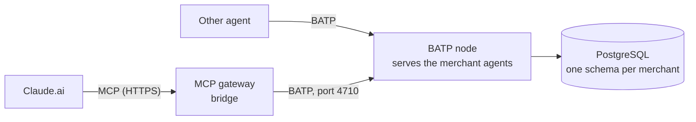

# BATP — Broad Agent Transfer Protocol (draft 0.1)

> Working name. Status: **draft**, implementation tracked in the issues linked from ADR-0011.
> This page is the short, readable version. The **normative** spec is the Internet-Draft
> [`rfc/draft-merchant-agents-batp-00`](rfc/draft-merchant-agents-batp-00.md)
> ([text](rfc/draft-merchant-agents-batp-00.txt), [HTML](rfc/draft-merchant-agents-batp-00.html)):
> where they differ, the draft wins and this page is a bug.
> Inspired by the AGTP Internet-Draft (an application protocol reserved for agent traffic), but
> independent from it: BATP is ours, small, and only what the merchant network needs.

## 1. Why a protocol of our own

Merchant agents form an **agent-only network**: every participant is software acting for a
person (a user's assistant) or a business (a restaurant's agent). On HTTP, that traffic looks
like any web traffic. BATP gives it a dedicated channel, with its own port, that says on every
frame **which agent is talking, what it intends to do, and to which merchant**.

Claude.ai only speaks MCP. So the MCP gateway stays, as a **bridge**. Claude calls the gateway's
tools, and the gateway speaks BATP to the node that serves the merchant agents. Any other agent
can speak BATP directly.



## 2. Terms

| Term | Meaning |
|---|---|
| **Node** | A BATP server. It serves the merchant agents of one backend (our registry). |
| **Merchant agent** | One merchant's booking logic and data, addressed by its slug. |
| **Caller** | An agent that opens a session with a node: a user's assistant, or a bridge acting for one. |
| **Session** | One TCP connection, from `HELLO` to close. |
| **Frame** | One JSON object on one line. |
| **Intent** | What a request asks for: `DISCOVER`, `AVAILABILITY`, `BOOK`, `AMEND`, `CANCEL`, `RECALL`, `PING`. |

## 3. Transport

- **TCP, port 4710.** It is unassigned in the IANA registry (range 4705–4710). BATP is not registered.
- **TLS 1.3** is required on any path other than loopback: the node refuses to listen beyond loopback without `BATP_TLS_CERT` and `BATP_TLS_KEY`. Plain TCP is allowed on loopback only.
- **Framing:** each frame is one JSON object in strict UTF-8 (no byte-order mark), written without line breaks, followed by `\n` (LF). A frame larger than **64 KiB** gets an `error` frame with `413` and the session is closed, before the node parses it. JSON that can't be parsed safely (invalid UTF-8, huge numbers, deep nesting) is a malformed frame (`400`).
- **One session, many requests:** a caller may send several requests without waiting. Every request carries an `id` (1 to 64 characters) chosen by the caller, unique among its unanswered requests. Responses carry the same `id` and **may arrive out of order**.
- **Idle sessions** are closed by the node after 60 s without a frame. `PING` keeps a session open.

## 4. Addressing

A merchant agent is addressed as `batp://<host>[:4710]/<slug>`, for example
`batp://191-96-88-152.sslip.io/le-petit-zinc`. The slug is the merchant's slug
(`^[a-z0-9-]{3,61}$`, AGENTS.md §0). Requests carry it in `merchant`, so one session can talk
to every merchant agent of a node.

## 5. Session

The caller speaks first. Until the node answers `WELCOME`, any other frame closes the session.

```json
{"type": "hello", "batp": "0.1",
 "agent": {"id": "urn:batp:agent:claude-gateway", "name": "Claude via the Sésame gateway",
           "kind": "user-agent", "operator": "merchant-agents"},
 "token": "…"}
```

- `agent.id` is a URN that names the calling agent. It is logged on every request.
- `agent.kind` is `user-agent` (acts for a guest) or `merchant-agent` (acts for a business).
- `token` is the caller's credential on this node: at least 16 characters, compared in constant time. A node may accept a `hello` without one on loopback only, when it has no tokens configured.

The node answers with one of these:

```json
{"type": "welcome", "batp": "0.1",
 "node": {"id": "urn:batp:node:merchant-agents", "name": "Sésame"},
 "intents": ["DISCOVER", "AVAILABILITY", "BOOK", "AMEND", "CANCEL", "RECALL", "PING"],
 "session": "s-2f6c…"}
```

```json
{"type": "reject", "status": 401, "message": "Unknown agent or token"}
```

`reject` closes the session. A `batp` major version the node does not speak gets `426`; a
`hello` that isn't valid gets `400`.

## 6. Requests and responses

```json
{"type": "request", "id": "r-1", "intent": "AVAILABILITY", "merchant": "le-petit-zinc",
 "params": {"date": "2026-11-02", "time": "20:00", "party_size": 4}}
```

```json
{"type": "response", "id": "r-1", "status": 200,
 "result": {"slots": [{"starts_at": "2026-11-02T20:00:00+01:00", "table_label": "T5"}]}}
```

```json
{"type": "response", "id": "r-2", "status": 413,
 "error": {"code": "party_too_large", "message": "Le Petit Zinc takes online bookings for up to 6 guests",
           "fallback_url": "http://localhost:8080/reservation.html"}}
```

- `params` and `result` reuse the tool contracts of `core/models.py` (see §7), so BATP and the MCP tools can never disagree.
- An error is never a stack trace (AGENTS.md §12). `error.code` is one of AGENTS.md §8.4, or `too_many_requests` with a `429` (§8).
- `fallback_url` is present for `agent_unavailable` and `party_too_large`.
- `merchant` is required for `AVAILABILITY`, `BOOK`, `AMEND` and `CANCEL`, and must be absent for the other intents (`400` otherwise).
- Unknown members of a **frame** are ignored, but `params` are strict: an unknown param gets `400 invalid_input`.
- A problem that no `id` can carry (invalid JSON, unknown `type`, an `id` already in flight, a frame above 64 KiB) gets a session-level `error` frame: `{"type": "error", "status": 400, "message": "…"}`. The session stays open after a `400`, and is closed after a `413`.

## 7. Intents

| Intent | `merchant` | `params` (`core.models`) | `result` | Served by |
|---|---|---|---|---|
| `DISCOVER` | — | `SearchMerchantsInput` | `SearchMerchantsOutput` | `gateway.discovery.search` |
| `AVAILABILITY` | required | `GetAvailabilityInput` without `merchant` | `GetAvailabilityOutput` | `AgentService.get_availability` |
| `BOOK` | required | `CreateReservationInput` without `merchant` | `ReservationOutput` | `AgentService.create_reservation` with `via = claude`: BATP bookings come from guests' agents, and the `kind` a caller declares is not trusted |
| `AMEND` | required | `UpdateReservationInput` without `merchant` | `ReservationOutput` | `AgentService.update_reservation` |
| `CANCEL` | required | `CancelReservationInput` without `merchant` | `ReservationOutput` | `AgentService.cancel_reservation(by="guest")` |
| `RECALL` | — | `GetMyReservationsInput` | `GetMyReservationsOutput` | `AgentService.find_guest_reservations` |
| `PING` | — | `{}` | `{"pong": true, "server_time": …}` | the node |

- `BOOK` and `AMEND` require `params.idempotency_key`. A `BOOK` replay with the same key (per merchant) and the same params returns the first booking; the same key with other params gets `400 invalid_input`. An `AMEND` replay with a key already applied (per merchant), for the same booking and params, changes nothing and returns the booking as it is now, so a late retry never undoes a newer change; another booking or other params get `400 invalid_input`, and a failed `AMEND` doesn't use up its key (#78). Like a `BOOK` replay, a replay returns the booking even if it was cancelled since. `BOOK` and `AMEND` keys are separate: one key per merchant and per intent. `CANCEL` is idempotent without a key.
- `RECALL` returns a notice on every call for 24 hours after the first one that returned it, then never again (#91). An answer lost in transit (dropped session, the caller's timeout) loses no notice as long as the next `RECALL` comes within those 24 hours, so `RECALL` is safe to send again, and `BatpClient` resends it after a lost session like the read-only intents.
- For a merchant marked `down`, the node itself answers `503` with the fallback URL to the addressed intents.
- Writes (`BOOK`, `AMEND`, `CANCEL`) are only sent after the guest confirmed (AGENTS.md §6). The bridge enforces it through the MCP tool descriptions; another caller is expected to do the same.
- Merchant-side operations (`list_reservations`, `block_slot`, …) are **not** BATP intents: they stay on the merchant platform (AGENTS.md §8.2).

## 8. Status codes

| Status | `error.code` | When | `fallback_url` |
|---|---|---|---|
| 200 | — | Success | — |
| 400 | `invalid_input` | Unknown intent, invalid params, missing or unexpected `merchant` | no |
| 401 | — | `hello` refused (unknown agent or token) | no |
| 404 | `not_found` | Unknown or not live merchant, unknown booking | no |
| 409 | `slot_unavailable` | Slot taken or blocked | no |
| 413 | `party_too_large` | Party above the limit or no table fits (a frame above 64 KiB gets an `error` frame with `413` instead) | yes |
| 426 | — | Unsupported `batp` version | no |
| 429 | `too_many_requests` | Too many requests in flight; retry after an earlier response | no |
| 503 | `agent_unavailable` | Merchant `down`, agent error or timeout | yes |

## 9. Events (reserved)

`{"type": "event", …}` frames, pushed by the node without a request, are reserved for 0.2. One
use would be to tell a guest's agent that the merchant cancelled their booking. Today that goes
through the guest notice returned by `RECALL`.

## 10. Security

- **Identity:** every request is attributed to the `agent.id` of its session, in the node's logs. Guest names are never logged at INFO (AGENTS.md §12).
- **Credentials:** one token per known agent (node configuration), compared in constant time.
- **Exposure:** in the POC the node listens on `127.0.0.1:4710`, and only the gateway on the same host reaches it. Opening 4710 on the team server needs TLS and a firewall rule on a shared machine, so ask first (AGENTS.md §0).
- **Limits:**
  - 64 KiB per frame (an answer that would exceed it becomes `503`);
  - 10 s to say `HELLO`, then 60 s idle timeout (no frame and no request in flight);
  - 10 s per request on the node (`503` past that);
  - at least 32 requests in flight per session: beyond the node's limit, extra requests get `429 too_many_requests` and may be sent again once earlier ones are answered;
  - 64 sessions per node, the next one gets a `503` reject;
  - a session closes after 10 malformed frames in a row, or when its peer stops reading for 10 s.
- **Bounded work:** a `DISCOVER` takes at most 32 tags and a 500-character query (`gateway.discovery.MAX_TAGS`, `MAX_QUERY`, shared with the gateway's `search_merchants`).
- **Logging:** refused sessions are logged at WARNING with the peer address and the agent they claimed, never the token. Database errors never carry query parameters (guest names).
- **Guest identity** is only the guest name and the booking reference (AGENTS.md §13). Fine for the POC with trusted callers; the draft's Security Considerations say what a real deployment needs.

## 11. Example session

```text
→ {"type":"hello","batp":"0.1","agent":{"id":"urn:batp:agent:claude-gateway","name":"…","kind":"user-agent","operator":"merchant-agents"}}
← {"type":"welcome","batp":"0.1","node":{"id":"urn:batp:node:merchant-agents","name":"Sésame"},"intents":["DISCOVER",…],"session":"s-1"}
→ {"type":"request","id":"r-1","intent":"DISCOVER","params":{"query":"table for 4 tonight","filters":{"tags":["vegetarian"],"max_price":"€€"}}}
← {"type":"response","id":"r-1","status":200,"result":{"merchants":[…],"suggestions":[],"ignored_filters":[]}}
→ {"type":"request","id":"r-2","intent":"BOOK","merchant":"le-petit-zinc","params":{"starts_at":"2026-11-02T20:00:00+01:00","party_size":4,"guest_name":"Ada","idempotency_key":"k-9"}}
← {"type":"response","id":"r-2","status":200,"result":{"reservation":{"id":"R-001",…}}}
```

## 12. The MCP bridge

The gateway keeps its 6 MCP tools and their descriptions. Behind them, an `AgentClient`
implementation speaks BATP to the node instead of calling `PgAgentService` in-process:

| MCP tool | BATP intent |
|---|---|
| `search_merchants` | `DISCOVER` |
| `get_availability` | `AVAILABILITY` |
| `create_reservation` | `BOOK` |
| `update_reservation` | `AMEND` |
| `cancel_reservation` | `CANCEL` |
| `get_my_reservations` | `RECALL` |

The gateway's fallback layer (`fallback.py`) serves both modes. Its 2 s budget includes the hop
to the node, and a BATP `503` or a dropped session becomes `agent_unavailable` with the
fallback URL. A refusal from the node (`400`, `404`, `409`, `413`) keeps its own §8.4 code, also
on `search_merchants`: the node answered, so it is never reported as an outage (#90).

`BatpClient` keeps at most 32 of the requests it waits on in flight, the minimum every node
accepts; the others wait for a slot within the gateway's budget. A request the gateway gave up
on may still run on the node for up to 10 s, so a slow node can still answer `429` to a later
one. That `429`, a status or `error.code` the bridge doesn't know, or an answer it can't read
fails that request only, as `agent_unavailable` with the fallback URL; the session and the
other requests go on. An unreadable answer without an `id` drops the session, since nobody can
tell whose it was. Any `2xx` is a success. The draft would treat an unknown `4xx` as a caller
error; the bridge can't fix the request for Claude, so it gives the restaurant's link instead.

The gateway keeps reading the registry itself for the `down` status and the fallback URL, so that
a dead node still gives the restaurant's link. For the same reason, when `DISCOVER` fails and the
query names a merchant, `search_merchants` answers with that merchant's link. The gateway names
each request (`BatpClient.request(request_id=…)`) and logs its id as `batp_request`, which the
node logs as `request`. Without `BATP_URL`, the gateway calls the agent in its own process.

## 13. Implementation

| Part | Where | State |
|---|---|---|
| Messages, framing, status codes, client, generic node | `code/packages/batp/` (`batp.messages`, `batp.codec`, `batp.status`, `batp.client`, `batp.server`) | ✅ #60 |
| The node of this backend | `code/packages/merchant_node/` (`make node`, `uv run python -m merchant_node`), settings `BATP_HOST`, `BATP_PORT`, `BATP_TOKENS` | ✅ #60 |
| The MCP gateway as a bridge | `gateway/agent_client.py` (`BatpAgentClient`), settings `BATP_URL`, `BATP_TOKEN` | ✅ #61 |
| The node on the team server (loopback) | `code/deploy/merchant-node.service`, `make deploy` | ✅ #62 |
| RFC-style Internet-Draft of this spec | `documentation/rfc/` | 🚧 #63 |

Without `BATP_TOKENS`, the node lets any agent in, and refuses to start unless it listens on loopback.

## 14. Versioning

`batp` is `major.minor`. The caller sends the highest version it speaks. A node with the same
major answers `welcome` with the highest minor both speak, and refuses another major with
`426`. A new intent or a new optional field is a minor change. Unknown fields in a frame are
ignored; because `params` are strict, a caller only sends the params of the session's version.

## 15. Where the reference node still differs from the draft

The Internet-Draft is the normative text. The node in `packages/batp/` (#60) was written in
parallel and still differs on one point:

- **`via`:** the node records every BATP booking as `claude`, whatever `kind` the caller
  declares (§7). The draft's BOOK section still says `merchant` for a `merchant-agent`.

Aligned since #93: an `id` already in flight gets an `error` frame and is not carried out;
`merchant` is checked per intent; the session closes on the 10th malformed frame in a row;
frames without a request `id` (not JSON, unknown `type`, no or invalid `id`, above 64 KiB) get
`error` frames; and the node's own `503` (handler timeout or failure, answer too large) carries
the merchant's `fallback_url`, looked up within 1 s. A refused duplicate doesn't count as
malformed: it is a valid frame.
