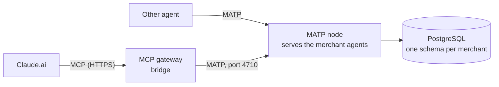

# MATP — Merchant Agent Transfer Protocol (draft 0.1)

> Working name. Status: **draft**, implementation tracked in the issues linked from ADR-0011.
> Inspired by the AGTP Internet-Draft (an application protocol reserved for agent traffic), but
> independent from it: MATP is ours, small, and only what the merchant network needs.

## 1. Why a protocol of our own

Merchant agents form an **agent-only network**: every participant is software acting for a
person (a user's assistant) or a business (a restaurant's agent). On HTTP, that traffic looks
like any web traffic. MATP gives it a dedicated channel, with its own port, that says on every
frame **which agent is talking, what it intends to do, and to which merchant**.

Claude.ai only speaks MCP. So the MCP gateway stays, as a **bridge**. Claude calls the gateway's
tools, and the gateway speaks MATP to the node that serves the merchant agents. Any other agent
can speak MATP directly.



## 2. Terms

| Term | Meaning |
|---|---|
| **Node** | A MATP server. It serves the merchant agents of one backend (our registry). |
| **Merchant agent** | One merchant's booking logic and data, addressed by its slug. |
| **Caller** | An agent that opens a session with a node: a user's assistant, or a bridge acting for one. |
| **Session** | One TCP connection, from `HELLO` to close. |
| **Frame** | One JSON object on one line. |
| **Intent** | What a request asks for: `DISCOVER`, `AVAILABILITY`, `BOOK`, `AMEND`, `CANCEL`, `RECALL`, `PING`. |

## 3. Transport

- **TCP, port 4710.** It is unassigned in the IANA registry (range 4705–4710). MATP is not registered.
- **TLS** is required whenever the connection leaves the host or a private network. Plain TCP is allowed on loopback for development.
- **Framing:** each frame is one UTF-8 JSON object followed by `\n` (LF). A frame larger than **64 KiB** closes the session with `413` before the node parses it.
- **One session, many requests:** a caller may send several requests without waiting. Every request carries an `id` chosen by the caller, unique within the session. Responses carry the same `id` and **may arrive out of order**.
- **Idle sessions** are closed by the node after 60 s without a frame. `PING` keeps a session open.

## 4. Addressing

A merchant agent is addressed as `matp://<host>[:4710]/<slug>`, for example
`matp://191-96-88-152.sslip.io/le-petit-zinc`. The slug is the merchant's slug
(`^[a-z0-9-]{3,61}$`, AGENTS.md §0). Requests carry it in `merchant`, so one session can talk
to every merchant agent of a node.

## 5. Session

The caller speaks first. Until the node answers `WELCOME`, any other frame closes the session.

```json
{"type": "hello", "matp": "0.1",
 "agent": {"id": "urn:matp:agent:claude-gateway", "name": "Claude via the merchant-agents gateway",
           "kind": "user-agent", "operator": "merchant-agents"},
 "token": "…"}
```

- `agent.id` is a URN that names the calling agent. It is logged on every request.
- `agent.kind` is `user-agent` (acts for a guest) or `merchant-agent` (acts for a business).
- `token` is the caller's credential on this node. It is optional on loopback in development.

The node answers with one of these:

```json
{"type": "welcome", "matp": "0.1",
 "node": {"id": "urn:matp:node:merchant-agents", "name": "Merchant Agents"},
 "intents": ["DISCOVER", "AVAILABILITY", "BOOK", "AMEND", "CANCEL", "RECALL", "PING"],
 "session": "s-2f6c…"}
```

```json
{"type": "reject", "status": 401, "message": "Unknown agent or token"}
```

`reject` closes the session. A `matp` version the node does not speak gets `426`.

## 6. Requests and responses

```json
{"type": "request", "id": "r-1", "intent": "AVAILABILITY", "merchant": "le-petit-zinc",
 "params": {"date": "2026-11-02", "time": "20:00", "party_size": 4}}
```

```json
{"type": "response", "id": "r-1", "status": 200,
 "result": {"slots": [{"starts_at": "2026-11-02T20:00:00+01:00", "table_label": "T5"}]}}
```

```json
{"type": "response", "id": "r-2", "status": 413,
 "error": {"code": "party_too_large", "message": "Le Petit Zinc takes online bookings for up to 6 guests",
           "fallback_url": "http://localhost:8080/reservation.html"}}
```

- `params` and `result` reuse the tool contracts of `core/models.py` (see §7), so MATP and the MCP tools can never disagree.
- An error is never a stack trace (AGENTS.md §12). `error.code` is one of AGENTS.md §8.4.
- `fallback_url` is present for `agent_unavailable` and `party_too_large`.

## 7. Intents

| Intent | `merchant` | `params` (`core.models`) | `result` | Served by |
|---|---|---|---|---|
| `DISCOVER` | — | `SearchMerchantsInput` | `SearchMerchantsOutput` | `gateway.discovery.search` |
| `AVAILABILITY` | required | `GetAvailabilityInput` without `merchant` | `GetAvailabilityOutput` | `AgentService.get_availability` |
| `BOOK` | required | `CreateReservationInput` without `merchant` | `ReservationOutput` | `AgentService.create_reservation` (`via` from the caller's kind) |
| `AMEND` | required | `UpdateReservationInput` without `merchant` | `ReservationOutput` | `AgentService.update_reservation` |
| `CANCEL` | required | `CancelReservationInput` without `merchant` | `ReservationOutput` | `AgentService.cancel_reservation(by="guest")` |
| `RECALL` | — | `GetMyReservationsInput` | `GetMyReservationsOutput` | `AgentService.find_guest_reservations` |
| `PING` | — | `{}` | `{"pong": true, "server_time": …}` | the node |

- `BOOK` and `AMEND` require `params.idempotency_key`. A replay with the same key returns the first result.
- Writes (`BOOK`, `AMEND`, `CANCEL`) are only sent after the guest confirmed (AGENTS.md §6). The bridge enforces it through the MCP tool descriptions; another caller is expected to do the same.
- Merchant-side operations (`list_reservations`, `block_slot`, …) are **not** MATP intents: they stay on the merchant platform (AGENTS.md §8.2).

## 8. Status codes

| Status | `error.code` | When | `fallback_url` |
|---|---|---|---|
| 200 | — | Success | — |
| 400 | `invalid_input` | Malformed frame, unknown intent, invalid params | no |
| 401 | — | `hello` refused (unknown agent or token) | no |
| 404 | `not_found` | Unknown or not live merchant, unknown booking | no |
| 409 | `slot_unavailable` | Slot taken or blocked | no |
| 413 | `party_too_large` | Party above the limit or no table fits; also a frame above 64 KiB (no `error.code`) | yes |
| 426 | — | Unsupported `matp` version | no |
| 503 | `agent_unavailable` | Merchant `down`, agent error or timeout | yes |

## 9. Events (reserved)

`{"type": "event", …}` frames, pushed by the node without a request, are reserved for 0.2. One
use would be to tell a guest's agent that the merchant cancelled their booking. Today that goes
through the guest notice returned by `RECALL`.

## 10. Security

- **Identity:** every request is attributed to the `agent.id` of its session, in the node's logs. Guest names are never logged at INFO (AGENTS.md §12).
- **Credentials:** one token per known agent (node configuration), compared in constant time.
- **Exposure:** in the POC the node listens on `127.0.0.1:4710`, and only the gateway on the same host reaches it. Opening 4710 on the team server needs TLS and a firewall rule on a shared machine, so ask first (AGENTS.md §0).
- **Limits:** 64 KiB per frame, 60 s idle timeout, at most 32 requests in flight per session: beyond that, extra requests get `400` until earlier ones are answered.

## 11. Example session

```text
→ {"type":"hello","matp":"0.1","agent":{"id":"urn:matp:agent:claude-gateway","name":"…","kind":"user-agent","operator":"merchant-agents"}}
← {"type":"welcome","matp":"0.1","node":{"id":"urn:matp:node:merchant-agents","name":"Merchant Agents"},"intents":["DISCOVER",…],"session":"s-1"}
→ {"type":"request","id":"r-1","intent":"DISCOVER","params":{"query":"table for 4 tonight","filters":{"tags":["vegetarian"],"max_price":"€€"}}}
← {"type":"response","id":"r-1","status":200,"result":{"merchants":[…],"suggestions":[],"ignored_filters":[]}}
→ {"type":"request","id":"r-2","intent":"BOOK","merchant":"le-petit-zinc","params":{"starts_at":"2026-11-02T20:00:00+01:00","party_size":4,"guest_name":"Ada","idempotency_key":"k-9"}}
← {"type":"response","id":"r-2","status":200,"result":{"reservation":{"id":"R-001",…}}}
```

## 12. The MCP bridge

The gateway keeps its 6 MCP tools and their descriptions. Behind them, an `AgentClient`
implementation speaks MATP to the node instead of calling `PgAgentService` in-process:

| MCP tool | MATP intent |
|---|---|
| `search_merchants` | `DISCOVER` |
| `get_availability` | `AVAILABILITY` |
| `create_reservation` | `BOOK` |
| `update_reservation` | `AMEND` |
| `cancel_reservation` | `CANCEL` |
| `get_my_reservations` | `RECALL` |

The gateway's fallback layer (`fallback.py`) is unchanged. Its 2 s budget now includes the hop
to the node, and a MATP `503` or a dropped session becomes `agent_unavailable` with the
fallback URL.

## 13. Versioning

`matp` is `major.minor`. A node refuses another major with `426`. A new intent or a new
optional field is a minor change. Unknown fields in a frame are ignored, so a 0.2 caller can
talk to a 0.1 node.
