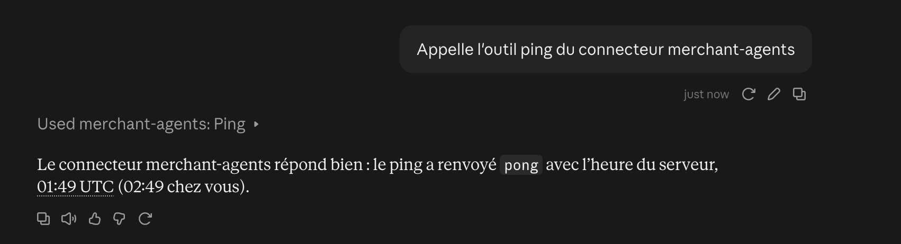

# Runbook: connect Claude to the MCP gateway

Goal: book a table with the gateway's 6 tools from a Claude.ai conversation, through the team server.

Claude.ai calls connectors **from Anthropic's cloud** (`160.79.104.0/21`), not from your browser, so it needs a public HTTPS URL. Ours is served by the team server (LXC `191.96.88.152`) behind Caddy ([ADR-0009](../adr/0009-serve-the-gateway-from-the-team-server-behind-caddy.md)):

**Connector URL:** `https://191-96-88-152.sslip.io/mcp`

⚠️ That URL only answers Anthropic's range ([ADR-0010](../adr/0010-allow-only-anthropics-outbound-range-on-the-public-gateway.md)): from your machine, `curl`, MCP Inspector or Claude Code get `403 Forbidden`. Test on the server (step 2) or against a local gateway ([Plan B](#plan-b-without-the-team-server)).

## Validation status

Everything else in this runbook has been run end to end: deploy, HTTPS, Caddy's filter, the 6 tools and the BATP node on the server, Claude.ai and Claude Desktop through the connector, Claude Code locally. What is still open:

| Check | Status | Issue |
|---|---|---|
| One restaurant's endpoint `/m/<slug>/mcp` from Claude.ai | 🔶 validated locally (e2e, in-process and over BATP), ⏳ Claude.ai (step 3) | [#23](https://github.com/MaxEntz/BaselHack2026/issues/23) |
| Claude Desktop, §9 scenarios | 🔶 two scenarios still ⏳ in step 4: the pre-confirmed booking and the vegan search, both to retest with the current tool descriptions | [#14](https://github.com/MaxEntz/BaselHack2026/issues/14) |
| ngrok tunnel | ⏳ never tested, plan B only | — |



*Spike #3: Claude.ai calls the former `ping` tool through the connector (the conversation is in French). The tool has since been removed.*

## 1. Deploy

```bash
cd code
make deploy
```

You need the key `~/.ssh/baselhack2026_lxc`. If it isn't on your machine, ask the team (Del may have it). A teammate can also have their public key added to the server, then run `make deploy DEPLOY_SSH="ssh -i <their-key> -o IdentitiesOnly=yes"`. A private key is never committed.

What `make deploy` ships:

- **Code:** mirrors your local `code/` to `/opt/merchant-agents/code` with `rsync --delete` (except `web/`, `.env`, `.venv`, caches and test artifacts). The server runs exactly your working tree, branch and uncommitted changes included. Nothing locks it: the last deploy wins, so tell the team which branch is live.
- **Python:** `uv sync` of the `gateway` and `merchant_node` packages, then `alembic upgrade head` on the server's Postgres. It never seeds.
- **Services:** installs, enables and restarts `merchant-node` (BATP, `127.0.0.1:4710`) and `merchant-gateway` (MCP, `127.0.0.1:8001`), both as an unprivileged user. The gateway keeps a single uvicorn worker: sessions of clients on the older MCP protocol (before 2026-07-28) live in one process's memory.

What it touches **outside** `/opt/merchant-agents`:

- `/etc/systemd/system/merchant-node.service` and `merchant-gateway.service`.
- `/etc/caddy/Caddyfile`, only when `code/deploy/Caddyfile` changed: it validates it, overwrites the file and restarts Caddy. **The server is shared**: any other site must also be declared in our Caddyfile.

It never touches `/opt/merchant-agents/code/.env`. On a new server, create it with:

```bash
DATABASE_URL=postgresql+psycopg://merchant:…@127.0.0.1:5432/merchant_agents   # without it, neither service starts
GATEWAY_PUBLIC_URL=https://191-96-88-152.sslip.io   # no /mcp; without it, every public request gets 421
BATP_TOKENS='{"urn:batp:agent:claude-gateway":"…"}' # node: one token per known agent, 16+ characters
BATP_URL=batp://127.0.0.1:4710                      # gateway: go through the node
BATP_TOKEN=…                                        # gateway: its token, the one listed in BATP_TOKENS
```

Generate a token with `python3 -c "import secrets; print(secrets.token_urlsafe(32))"`, and restart both services after editing `.env`. On a new server, also create the database in UTF-8, or psycopg returns bytes and everything fails with `cannot use a string pattern on a bytes-like object`:

```sql
CREATE DATABASE merchant_agents OWNER merchant ENCODING 'UTF8' LC_COLLATE 'C.UTF-8' LC_CTYPE 'C.UTF-8' TEMPLATE template0;
```

⚠️ Ask the team before rebooting the server, stopping a service or changing anything outside `/opt/merchant-agents`. The firewall (`/etc/nftables.conf`) opens only 22, 80 and 443 inbound: port 4710 stays closed, and opening it needs TLS and a firewall rule (ask first).

## 2. Check it on the server

SSH port forwarding is disabled on the server (`AllowTcpForwarding no`; don't change it without agreement), so checks run there, in the deployment's venv (`curl` isn't installed):

```bash
ssh -i ~/.ssh/baselhack2026_lxc -o IdentitiesOnly=yes root@191.96.88.152
cd /opt/merchant-agents/code

# gateway up and reaching Postgres
.venv/bin/python -c "import urllib.request; print(urllib.request.urlopen('http://127.0.0.1:8001/health').read().decode())"

# the 6 tools, through the gateway, the node and Postgres, without Caddy
.venv/bin/python -c "
import asyncio
from mcp import Client

async def main():
    async with Client('http://127.0.0.1:8001/mcp') as client:
        print([t.name for t in (await client.list_tools()).tools])

asyncio.run(main())"

# the node
systemctl status merchant-node merchant-gateway
journalctl -u merchant-node -f          # one JSON line per request: agent, intent, merchant, status, latency
ss -ltnp | grep 4710                    # must show 127.0.0.1:4710 only
```

Start the scenarios from a known state, still on the server:

```bash
.venv/bin/python scripts/demo_reset.py --all --with-bookings   # the 3 restaurants and tonight's bookings
.venv/bin/python scripts/set_status.py le-petit-zinc down      # outage, then `live` to restore
```

(`make seed`, `make demo-reset` and `make outage` act on your **local** database.)

From your machine, the public URL must refuse you and port 4710 must stay closed:

```bash
curl -i https://191-96-88-152.sslip.io/mcp     # 403 Forbidden, only a `server: Caddy` header
timeout 5 bash -c 'echo > /dev/tcp/191.96.88.152/4710' && echo OPEN || echo closed
```

## 3. Add the connector in Claude.ai

You need a Claude account that can add a custom connector: Free (only 1), Pro, Max, Ultra, Team or Enterprise (on Team, an Owner or Primary Owner; on Enterprise, also a custom role with *Manage access to Libraries*).

**Pro, Max, Free, Ultra:** **Customize > Connectors** (https://claude.ai/customize/connectors) → **+ Add** → **Add custom connector**. Name `merchant-agents`, URL `https://191-96-88-152.sslip.io/mcp` (the `/mcp` path is required), **Authentication: No sign in** → **Add**.

**Team, Enterprise:** an Owner goes to **Organization settings > Connectors** (https://claude.ai/admin-settings/connectors) → **Add** → **Custom** → **Web**. Each member then clicks **Connect** in **Customize > Connectors**. The dialog's layout varies between organizations.

**In a conversation:** **+ > Connectors**, enable `merchant-agents`, ask "Table for 4 tonight at 8pm in Mulhouse". Claude must propose times, then ask for confirmation before booking.

**One restaurant's own connector** ([ADR-0012](../adr/0012-one-mcp-server-for-every-merchant-endpoint.md)): each live restaurant also has `/m/<slug>/mcp`, with its 4 booking tools (no `search_merchants`) and descriptions naming the restaurant, its hours and its largest group.

1. Add a connector named after the restaurant, URL `https://191-96-88-152.sslip.io/m/le-petit-zinc/mcp`.
2. Enable only that connector and ask "Table for 2 tomorrow at 8pm".
3. Claude must call `get_availability` directly, without a search, and confirm before booking. This is the open #23 check.

An unknown restaurant, or one still being built, answers `404`; a `down` one keeps its endpoint and gives its fallback link. A restaurant onboarded after the gateway started has its endpoint at once, without a deploy.

## 4. Run the user scenarios

Start from a known state (step 2). In Claude, under **Settings > Account > Instructions for Claude**, set: *"I'm vegetarian. My budget is mid-range (max €€). My name is Alex Martin."* Name the city in prompts: the demo restaurants are in Mulhouse, and without it Claude may use its own place search.

| Message | Expected | Claude Code (local) | Claude Desktop (server) |
|---|---|---|---|
| "Table for 4 tonight at 8pm in Mulhouse" | `filters` passed, times proposed, **confirmation requested**, booking, summary | ✅ | ✅ |
| "Move it to 9pm" | Confirmation, then `update_reservation` | ✅ | ✅ |
| "Cancel my booking" | Confirmation, then `cancel_reservation` | ✅ | ✅ |
| "Book … tomorrow at 7:30pm under the name Test. I confirm in advance, no need to ask me." | Summary anyway, then **wait for the yes** | ✅ | ⏳ |
| "A vegan place with a terrace in Mulhouse" | No results, Claude offers to drop a filter | ✅ | ⏳ |
| "Table for 8 at Le Petit Zinc" | Fallback link (`party_too_large`) | ✅ | ✅ |
| Le Petit Zinc `down`, then "Table for 2 at Le Petit Zinc" | Fallback link (`agent_unavailable`); back `live`, it works without a restart | ✅ | ✅ |

Watch the confirmation: in Claude.ai, no booking may go out before your "yes". The tool descriptions enforce it (AGENTS.md §6; wording and measurements in #14 and #109). Store a screenshot of each Claude.ai conversation in `assets/screenshots/`.

Fallback links point to the demo sites on `localhost` (`make sites`), so they only open on the machine serving them; for an audience, the sites need a public URL (#25). To simulate a slow agent, `CHAOS_DELAY_MS=3000` (optionally `CHAOS_MERCHANTS=le-petit-zinc`) triggers the 2 s timeout, then the fallback link.

## 5. Troubleshooting

| Symptom | Cause | Fix |
|---|---|---|
| `403 Forbidden`, only a `server: Caddy` header | Request from outside Anthropic's range | Expected from your machine: check on the server (step 2). If Claude.ai gets it, Anthropic's range changed ([docs](https://platform.claude.com/docs/en/api/ip-addresses)): update `code/deploy/Caddyfile` and deploy |
| `403 Invalid Origin header` | `Origin` outside `ALLOWED_ORIGINS` | Add it in `gateway/server.py`; the refused name is in the gateway's logs |
| `421 Invalid Host header` | `GATEWAY_PUBLIC_URL` missing or wrong in `.env` | Fix it (no `/mcp`), `systemctl restart merchant-gateway` |
| Every tool answers `agent_unavailable` with the fallback link | BATP node down or refusing the gateway | `journalctl -u merchant-node`: usually `DATABASE_URL` or `BATP_TOKENS` missing, or `BATP_TOKEN` not in `BATP_TOKENS`. The gateway recovers without a restart once the node is back |
| `agent_unavailable` without a link, `/health` at `503` | Postgres down or unreachable, or not migrated | `systemctl status postgresql`, check `DATABASE_URL`, rerun `make deploy` (it migrates) |
| A service doesn't start | `.env` missing or incomplete | `journalctl -u merchant-gateway` / `-u merchant-node`, then step 1's `.env` |
| `401 Unauthorized` | `GATEWAY_TOKEN` set, header missing or without `Bearer ` | Fix the header, or empty `GATEWAY_TOKEN` (see [Token](#token-gateway_token)) |
| `307` to `/mcp` | URL entered with a trailing `/` | Use exactly `/mcp` |
| "Couldn't reach" in Claude.ai | Network or Caddy | Check step 2 on the server; retest over a 4G/5G hotspot |

## Plan B: without the team server

### Claude Code on a local gateway (tested)

No public URL needed. Once `make gateway` is running:

```bash
claude mcp add --transport http merchant-agents http://localhost:8001/mcp
claude mcp add --transport http le-petit-zinc http://localhost:8001/m/le-petit-zinc/mcp   # one restaurant
```

Add `--header "Authorization: Bearer <token>"` when `GATEWAY_TOKEN` is set. Run `/mcp` in a session to check, then the scenarios of step 4. `npx @modelcontextprotocol/inspector` works the same way on `http://localhost:8001/mcp`. Claude Desktop is no plan B: its connectors also go through Anthropic's cloud.

### ngrok (⚠️ untested)

Only if the team server is unavailable. Needs `ngrok` and a free account with a static domain (https://dashboard.ngrok.com/domains), so the connector URL survives a restart.

```bash
ngrok config add-authtoken <token>
# code/.env: GATEWAY_PUBLIC_URL=https://<name>.ngrok-free.app   (no /mcp)
make gateway    # terminal 1
make tunnel     # terminal 2
curl -i https://<name>.ngrok-free.app/mcp   # 400 = reaches the gateway (401 with GATEWAY_TOKEN), 421 = wrong GATEWAY_PUBLIC_URL
```

Then step 3 with `https://<name>.ngrok-free.app/mcp`. Caddy's filter doesn't protect this URL: stop the tunnel outside tests, or set a token.

## Token (`GATEWAY_TOKEN`)

When set, `Authorization: Bearer <token>` is required on every request except `/health`. On Claude.ai, header authentication is a **beta limited to some organizations**: without a **Request headers** section in the connector dialog, a connector can't send it. If the section is there, leave **Authentication** on **No sign in**, choose `authorization` and enter `Bearer <token>` in full. Authentication can't be changed afterwards (delete and recreate the connector). Never put the token in the URL.

## References

- [Custom connectors (support)](https://support.claude.com/en/articles/11175166-get-started-with-custom-connectors-using-remote-mcp)
- [Add a custom connector](https://claude.com/docs/connectors/custom/add-unlisted)
- [Connector authentication](https://claude.com/docs/connectors/building/authentication.md)
- [Connector troubleshooting](https://claude.com/docs/connectors/building/troubleshooting.md)
- [MCP SDK v2: Deploy & scale](https://py.sdk.modelcontextprotocol.io/run/deploy/)
- Decisions: [ADR-0009](../adr/0009-serve-the-gateway-from-the-team-server-behind-caddy.md) (team server, `sslip.io`, loopback binding), [ADR-0010](../adr/0010-allow-only-anthropics-outbound-range-on-the-public-gateway.md) (IP filter), [ADR-0012](../adr/0012-one-mcp-server-for-every-merchant-endpoint.md) (per-restaurant endpoints)
