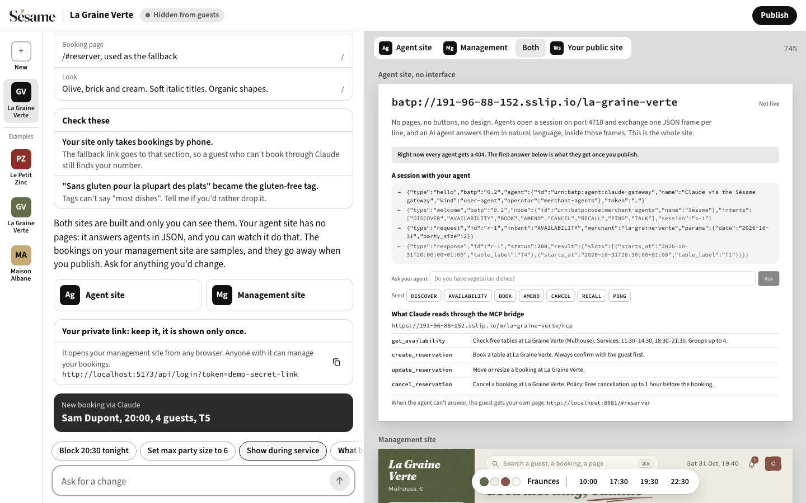
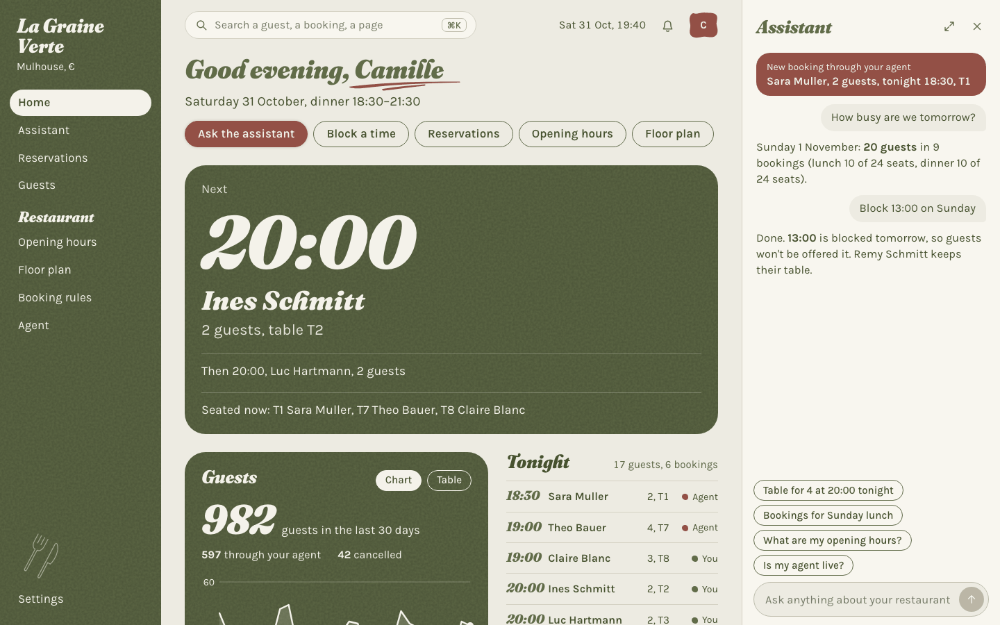
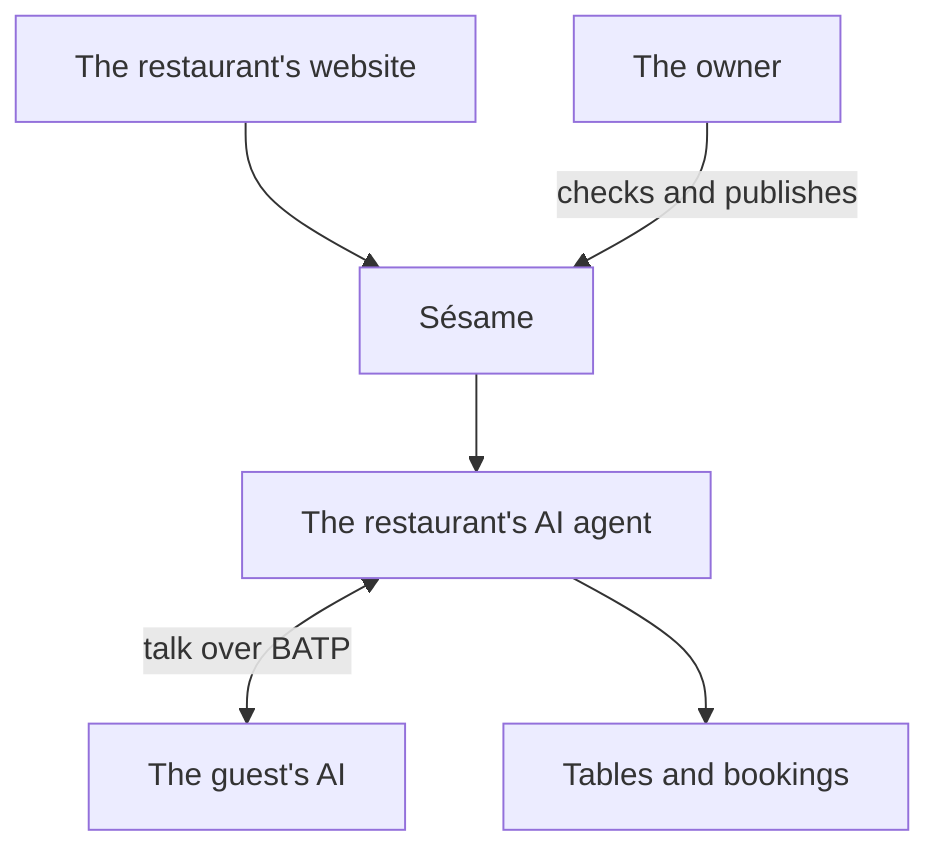

<p align="center">
  <picture>
    <source media="(prefers-color-scheme: dark)" srcset="assets/logo/sesame-wordmark-on-dark.png">
    
  </picture>
</p>

<h3 align="center">Create your AI from your site.</h3>

<p align="center">
  Sésame turns a restaurant's website into an AI agent that other AIs can talk to:<br>
  to ask about the menu, find a table and book it.
</p>

<p align="center">
  <a href="https://sesame.191-96-88-152.sslip.io">Live app</a> ·
  <a href="#see-it">Screenshots</a> ·
  <a href="#how-it-works">How it works</a> ·
  <a href="#try-it">Try it</a>
</p>

<p align="center"><sub>Built at BaselHack 2026 for Adobe's challenge, <i>The Post-Website Business</i>.</sub></p>

## Why

A restaurant's first visitor is often no longer a person: a guest asks an AI for a table and never opens a browser. Websites were made for people, and that AI has to find its way through pages and forms.

Small restaurants already lost control once to the booking platforms. They shouldn't lose discovery a second time, or need a developer to be ready.

## What it does

**For the owner.** They give Sésame their website and a few sentences about how they work. Sésame reads the site, shows what it understood and where it read it, and waits for their check before anything goes public. They then run their restaurant by chatting, or from a management site in the restaurant's own look, and bookings arrive live.

**For the guest.** They ask their AI: *"Table for 4 tonight at 8pm, do you have vegetarian dishes?"* Their AI talks to the restaurant's agent, which answers from what the site says, offers free times and prepares the booking. The agent's AI model can't book anything by itself: a booking only runs on a confirmation of what the agent proposed.

**The website stays.** When the agent can't help, or the group is too large, the guest gets the link to the restaurant's own booking page.

## See it



*Studio, where an owner builds and publishes by chatting. On the left, what Sésame understood from the site. On the right, the agent site: it has no pages, only what agents exchange with it.*



*The management site, in the restaurant's own look, with an assistant for the day's questions and changes.*

*Both screenshots run on demo data: the restaurants and the guests are fictional.*

## How it works



1. **Read.** Sésame reads the website and keeps the facts that matter, such as the hours, the menu, group sizes and how to get there, each with where it found them.
2. **Review.** The owner sees those facts, corrects what's wrong, and publishes.
3. **Talk.** Guests' AIs talk to the restaurant's agent in natural language. It answers, and calls its own booking tools.
4. **Book.** Once confirmed, the booking appears on the management site within 2 seconds.

Agents talk through **BATP**, a small protocol of our own, made for agents talking to agents. Claude connects through our gateway, which carries its messages over BATP.

## Today and next

**What works today**

- An agent built from a website, and checked by its owner before it goes public
- One AI agent per restaurant, which answers other agents in natural language
- The owner's chat and management site, with bookings arriving live
- The restaurant's own booking page as the fallback

**What doesn't, yet**

- Only restaurants, in one city. More kinds of business come next.
- Outside agents can't connect to BATP directly yet: they go through our gateway.
- Anyone can onboard a website: proving they own it comes next.
- A guest is only a name, with no account.
- No payments, and no ranking between restaurants that match: fair discovery comes next.

## Try it

**Online:** [sesame.191-96-88-152.sslip.io](https://sesame.191-96-88-152.sslip.io). Building a new restaurant there needs an invitation.

**On your machine, with demo data:** you need [uv](https://docs.astral.sh/uv/) and Node.js ([versions](code/README.md#prerequisites)).

```bash
cd code
make setup
VITE_MOCK=1 make web   # http://localhost:5173
```

To run it for real, with the agent and a model, see [`code/README.md`](code/README.md#run-it-for-real).

## Go deeper

| | |
|---|---|
| [Architecture](documentation/ARCHITECTURE.md) | The components, the main flow, and what each one does not do |
| [Protocol](documentation/PROTOCOL.md) | BATP in short, and its [RFC-style draft](documentation/rfc/draft-merchant-agents-batp-00.txt) |
| [Decisions](documentation/adr/README.md) | Why it is built this way, such as [giving each merchant an AI agent](documentation/adr/0021-give-each-merchant-an-ai-agent-that-guests-talk-to-over-batp.md) |
| [Code](code/README.md) | Every command, the services and the layout |
| [Runbooks](documentation/runbooks/demo.md) | The demo, and [connecting Claude](documentation/runbooks/connector.md) |
| [Mockups](documentation/design/poc-v10/README.md) | The design the web app was built from |
| [`AGENTS.md`](AGENTS.md) | The full spec, for people and coding agents |

## Team

[Antoine Malgat](https://github.com/ToadBleu) · [Enzo Laugel](https://github.com/Boz0o0) · [Maxime Entz](https://github.com/MaxEntz) · [Matteo Tutti](https://github.com/matteoepitech) · [Matthias Yildirim](https://github.com/Rimapus) · [Nicolas Bach](https://github.com/TheNotSoChosen0ne) · [Valentino Zarrillo](https://github.com/Chrystoval1) · [Yann Toison-Chabane](https://github.com/Yann-TC)

MIT licensed, see [`license.txt`](license.txt).
