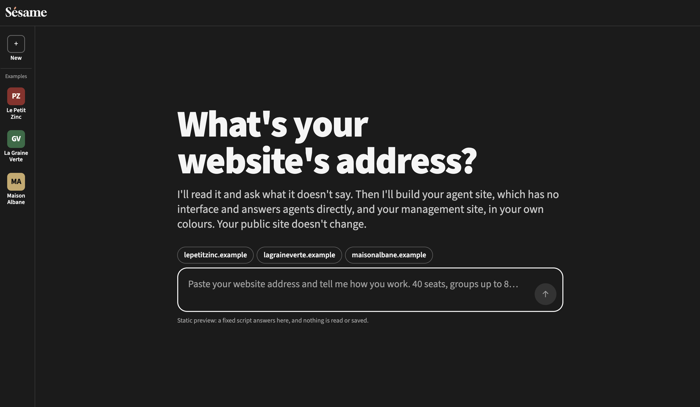
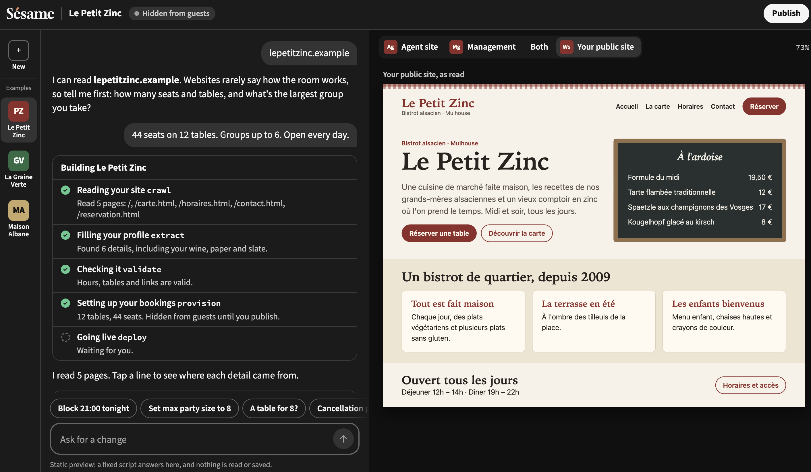

<p align="center"></p>

# Sésame

> Let Claude book with any merchant, straight from their website.

A restaurant owner gives us their website and describes how they work. We generate their booking agent. Anyone can then book a table by asking Claude, through a single MCP server that applies their preferences and sends them back to the restaurant's own site whenever the agent can't help. The owner runs everything by chatting with our platform, onboarding included, and sees bookings made through Claude appear live.

Built at BaselHack 2026, and still being built. §4 of the architecture document shows which components are merged, and issue [#26](https://github.com/MaxEntz/BaselHack2026/issues/26) tracks the plan.





*Sésame's merchant side, in its static preview (a fixed script answers, nothing is read or saved): the merchant gives their website's address, then watches their agent being built next to their public site. Restaurants and guests are fictional. Claude.ai calling our MCP gateway is shown in [this screenshot](documentation/runbooks/img/connector-ping.png).*

## How it works

- **User side.** Claude.ai calls our **gateway**, a remote MCP server, which routes the call to the merchant's **agent**. Each merchant's data lives in its own Postgres schema, and the database itself makes double booking impossible. On failure, the gateway returns the merchant's own booking page.
- **Merchant side.** The merchant uses a **web chat**, backed by the **platform API**. There, an **assistant** answers through admin tools ("What bookings do I have tonight?", "Block 21:00"), and the **builder** turns the merchant's website into a validated profile, then provisions the agent. The LLM only fills that profile; it never writes code or SQL.
- **Agent network.** Behind the gateway, the merchant agents form a network reserved for AI agents, with its own protocol: **BATP**, on TCP port 4710. Every session names the calling agent, and every request names its intent and merchant. Claude only speaks MCP, so the gateway is its bridge to BATP. The spec is an RFC-style Internet-Draft, [`draft-merchant-agents-batp-00`](documentation/rfc/draft-merchant-agents-batp-00.txt), summarized in [`documentation/PROTOCOL.md`](documentation/PROTOCOL.md); the node and the bridge are in progress (#60, #61).
- **Live.** A committed booking fires Postgres `NOTIFY`, which is pushed to the merchant's chat over SSE. The target is under 2 seconds.

➡️ **[documentation/ARCHITECTURE.md](documentation/ARCHITECTURE.md)** has the diagrams, the main flow step by step, every component and what it does *not* do, and the stack with its [decision records](documentation/adr/README.md).

## Quick start

Prerequisites: Python 3.12 with [uv](https://docs.astral.sh/uv/), Docker, Node.js ≥ 22.12.

```bash
cd code
make setup && make db && make migrate   # dependencies, Postgres 16, migrations
make test                                # unit + integration tests (needs Docker)
VITE_MOCK=1 make web                     # merchant chat on mock data -> http://localhost:5173
```

All the commands are in [`code/README.md`](code/README.md). To connect Claude.ai to the gateway, see [`documentation/runbooks/connector.md`](documentation/runbooks/connector.md).

## Repository layout

| Path | Content |
|---|---|
| [`code/`](code) | uv workspace (`core`, `agent`, `gateway`, `builder`, `merchant_platform`), web chat, demo site, migrations, tests |
| [`documentation/`](documentation) | Architecture, decision records, contracts, runbooks |
| [`assets/`](assets) | Presentation material |
| [`AGENTS.md`](AGENTS.md) | Full spec, shared by Claude Code (`CLAUDE.md`) and opencode |

## Team

| Name | GitHub |
|---|---|
| Enzo Laugel | [@Boz0o0](https://github.com/Boz0o0) |
| Maxime Entz | [@MaxEntz](https://github.com/MaxEntz) |
| Matteo Tutti | [@matteoepitech](https://github.com/matteoepitech) |
| Matthias Yildirim | [@Rimapus](https://github.com/Rimapus) |
| Nicolas Bach | [@TheNotSoChosen0ne](https://github.com/TheNotSoChosen0ne) |
| Valentino Zarrillo | [@Chrystoval1](https://github.com/Chrystoval1) |
| Yann Toison-Chabane | [@Yann-TC](https://github.com/Yann-TC) |

MIT licensed, see [`license.txt`](license.txt).
